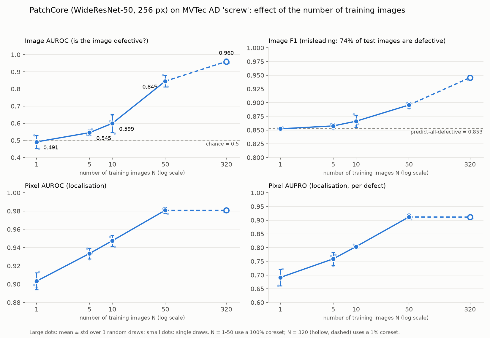
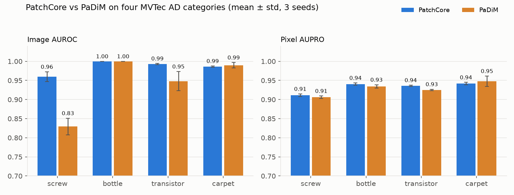
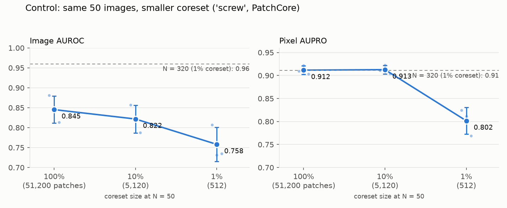

# Visual anomaly detection with limited data: PatchCore vs PaDiM on MVTec AD

Small manufacturers rarely have thousands of labelled defect images. They usually have **some photos of good parts and almost no photos of defects**. This project studies how well two unsupervised anomaly-detection methods, **PatchCore** and **PaDiM**, work in that situation, and how performance changes when only a handful of good training images is available.

It is the experimental part of my BSc thesis in Artificial Intelligence. All results come from one reproducible script and are stored as CSV files in this repository.



## Key findings

1. **PatchCore beats PaDiM at image-level detection on the hard categories**, and the two are equal on the easy ones. On `screw`, image AUROC is 0.960 vs 0.829. On `transistor` it is 0.993 vs 0.948. On `bottle` both reach 1.000 and on `carpet` the difference is within noise.
2. **Localisation is about equal.** Pixel AUPRO is within roughly 0.01 between the methods on all four categories.
3. **Few-shot (`screw`, PatchCore):** with 1, 5 or 10 good training images image AUROC stays close to chance (0.49 / 0.55 / 0.60). At 50 images it jumps to 0.85, and with all 320 images it reaches 0.96.
4. **Localisation needs fewer images than detection.** Pixel AUROC (0.981) and AUPRO (0.912) at N = 50 already match the full-data values, while image AUROC does not.
5. **Image diversity matters more than memory-bank size.** With the same 50 images, shrinking the bank from 51,200 to 5,120 patches costs about 0.02 image AUROC. Yet the full-data model uses only 3,276 patches and scores 0.96. A bank of 512 patches is too small (0.76).
6. **Image F1 can mislead.** 74% of the `screw` test images are defective, so predicting "defective" for everything already gives F1 = 0.853. Judge few-shot runs by AUROC.

## Results

All numbers are mean ± standard deviation over 3 seeds (42, 1, 2), on the official MVTec AD test split. PatchCore: WideResNet-50 backbone, layers 2+3, 256 px, 1% coreset, 9 neighbours. PaDiM: WideResNet-50, layers 1+2+3, 200 random channels, 256 px.

### PatchCore vs PaDiM, four categories



| category | method | image AUROC | image F1 | pixel AUROC | pixel AUPRO | pixel F1 |
|---|---|---|---|---|---|---|
| screw | PatchCore | 0.960 ± 0.013 | 0.946 ± 0.003 | 0.981 ± 0.001 | 0.911 ± 0.004 | 0.370 ± 0.003 |
| screw | PaDiM | 0.829 ± 0.022 | 0.888 ± 0.007 | 0.975 ± 0.001 | 0.906 ± 0.003 | 0.233 ± 0.009 |
| bottle | PatchCore | 1.000 ± 0.000 | 0.992 ± 0.000 | 0.985 ± 0.000 | 0.940 ± 0.003 | 0.724 ± 0.001 |
| bottle | PaDiM | 1.000 ± 0.000 | 0.992 ± 0.000 | 0.980 ± 0.001 | 0.934 ± 0.004 | 0.693 ± 0.007 |
| transistor | PatchCore | 0.993 ± 0.001 | 0.945 ± 0.007 | 0.965 ± 0.001 | 0.936 ± 0.002 | 0.603 ± 0.006 |
| transistor | PaDiM | 0.948 ± 0.025 | 0.856 ± 0.030 | 0.976 ± 0.002 | 0.925 ± 0.002 | 0.670 ± 0.016 |
| carpet | PatchCore | 0.986 ± 0.002 | 0.972 ± 0.005 | 0.990 ± 0.000 | 0.942 ± 0.003 | 0.603 ± 0.002 |
| carpet | PaDiM | 0.990 ± 0.007 | 0.979 ± 0.003 | 0.987 ± 0.004 | 0.948 ± 0.014 | 0.529 ± 0.063 |

### Few-shot experiment (`screw`, PatchCore)

N good training images are drawn at random (3 different draws per N). For N ≤ 50 the full memory bank is kept (coreset 100%).

| N train images | coreset | bank size (patches) | image AUROC | image F1 | pixel AUROC | pixel AUPRO | pixel F1 |
|---|---|---|---|---|---|---|---|
| 1 | 100% | 1,024 | 0.491 ± 0.038 | 0.852 ± 0.003 | 0.903 ± 0.009 | 0.691 ± 0.030 | 0.035 ± 0.001 |
| 5 | 100% | 5,120 | 0.545 ± 0.017 | 0.858 ± 0.005 | 0.934 ± 0.006 | 0.759 ± 0.023 | 0.052 ± 0.002 |
| 10 | 100% | 10,240 | 0.599 ± 0.054 | 0.866 ± 0.011 | 0.947 ± 0.006 | 0.803 ± 0.007 | 0.067 ± 0.002 |
| 50 | 100% | 51,200 | 0.845 ± 0.034 | 0.896 ± 0.005 | 0.981 ± 0.003 | 0.912 ± 0.009 | 0.280 ± 0.067 |
| 320 (all) | 1% | 3,276 | 0.960 ± 0.013 | 0.946 ± 0.003 | 0.981 ± 0.001 | 0.911 ± 0.004 | 0.370 ± 0.003 |

The last row uses a different coreset size than the others. To check that this does not explain the gap, I ran a control with the same 50 images and smaller coresets:



| coreset | bank size (patches) | image AUROC | pixel AUROC | pixel AUPRO | pixel F1 |
|---|---|---|---|---|---|
| 100% | 51,200 | 0.845 ± 0.034 | 0.981 ± 0.003 | 0.912 ± 0.009 | 0.280 ± 0.067 |
| 10% | 5,120 | 0.822 ± 0.035 | 0.980 ± 0.003 | 0.913 ± 0.009 | 0.275 ± 0.062 |
| 1% | 512 | 0.758 ± 0.043 | 0.939 ± 0.016 | 0.802 ± 0.029 | 0.243 ± 0.051 |

### Smaller ablations (`screw`, 3 seeds)

| configuration | image AUROC | pixel AUROC | pixel F1 | fit time [s] |
|---|---|---|---|---|
| PatchCore WRN50, 256 px, k=9 | 0.960 ± 0.013 | 0.981 | 0.370 | 38 |
| PatchCore WRN50, 256 px, k=1 | 0.960 ± 0.013 | 0.981 | 0.370 | 37 |
| PatchCore WRN50, 256 px, k=3 | 0.952 ± 0.007 | 0.981 | 0.370 | 38 |
| PatchCore ResNet-18, 256 px, k=9 | 0.953 ± 0.005 | 0.985 | 0.381 | 36 |
| PatchCore WRN50, 384 px, k=9 | 0.976 ± 0.003 | 0.992 | 0.488 | 1231 |
| PaDiM ResNet-18, 256 px | 0.759 ± 0.009 | 0.976 | 0.216 | 19 |
| PaDiM ResNet-18, 384 px | 0.732 ± 0.028 | 0.980 | 0.223 | 26 |
| PaDiM WRN50, 256 px | 0.829 ± 0.022 | 0.975 | 0.233 | 21 |

Higher resolution helps PatchCore on `screw` (small defects) but is about 30 times slower to fit. The number of neighbours `k` only changes the image-level score, never the anomaly map, so pixel metrics are identical for every `k`. Pixel AUPRO is not available for this ablation (it was added to the script later).

## Method in short

- **PatchCore** stores features of all patches of the good training images (a *memory bank*) and shrinks it with greedy *coreset* subsampling. A test patch is scored by its distance to the nearest stored patch. The image score is the largest patch score.
- **PaDiM** models the features at each image position as a Gaussian (mean and covariance over the training images) and scores a test patch by its Mahalanobis distance to that Gaussian.
- Both use an ImageNet-pretrained CNN as a frozen feature extractor. **No defect image is ever used for training.**

## Metrics

| metric | meaning |
|---|---|
| image AUROC | probability that a random defective image gets a higher score than a random good one |
| image F1 | F1 of the good/defective decision at the model's threshold |
| pixel AUROC | the same at pixel level (inflated by the many easy background pixels) |
| pixel AUPRO | per-defect-region overlap, averaged over thresholds. Treats small defects fairly |
| pixel F1 | F1 of the predicted vs true defect mask |

## Setup

Tested with Python 3.10+, `anomalib 2.7.0`, PyTorch 2.14.1 (CUDA 12.6) on an RTX 4060 Laptop GPU (8 GB).

```bash
python -m venv .venv
# Windows: .venv\Scripts\activate     Linux/macOS: source .venv/bin/activate

# 1) PyTorch with CUDA (pick the right command at https://pytorch.org/get-started/locally/), e.g.:
python -m pip install torch torchvision --index-url https://download.pytorch.org/whl/cu126

# 2) the rest
python -m pip install -r requirements.txt
```

Download the [MVTec AD dataset](https://www.mvtec.com/company/research/datasets/mvtec-ad) (not included in this repository) and extract it, e.g. to `data/mvtec/`. Each category folder must contain `train/good`, `test/<defect types>` and `ground_truth/<defect types>`.

## Usage

```bash
python run_experiment.py --root data/mvtec/screw --category screw --model patchcore \
    --backbone wide_resnet50_2 --coreset-ratio 0.01 --num-neighbors 9 --seeds 42 1 2 --out results.csv
```

Every run appends one row per seed to the CSV file (the header is checked first, so existing results are never overwritten). Main options:

| option | description |
|---|---|
| `--model` | `patchcore` (default) or `padim` |
| `--backbone` | `wide_resnet50_2` (PatchCore default), `resnet18` (PaDiM default), any timm backbone |
| `--coreset-ratio`, `--num-neighbors` | PatchCore memory-bank fraction and neighbours for the image score |
| `--n-features` | PaDiM number of random channels (the paper uses 550 for WRN50, which needs more than 8 GB of GPU memory; I used 200) |
| `--image-size` | input resolution (default 256) |
| `--n-train` | few-shot: draw N random training images for each seed |
| `--seeds` | one run per seed |
| `--save-errors` | save a figure with the worst false positive and false negative |

### Reproducing the experiments

```bash
# 4 categories x 2 methods x 3 seeds   (PowerShell: replace the loop syntax accordingly)
for c in screw bottle transistor carpet; do
  python run_experiment.py --root data/mvtec/$c --category $c --model patchcore --backbone wide_resnet50_2 --coreset-ratio 0.01 --seeds 42 1 2 --out results.csv
  python run_experiment.py --root data/mvtec/$c --category $c --model padim --backbone wide_resnet50_2 --n-features 200 --seeds 42 1 2 --out results.csv
done

# few-shot (full memory bank)
for n in 1 5 10 50; do
  python run_experiment.py --root data/mvtec/screw --category screw --backbone wide_resnet50_2 --coreset-ratio 1.0 --n-train $n --seeds 42 1 2 --out results.csv
done

# coreset control at N = 50
for r in 0.1 0.01; do
  python run_experiment.py --root data/mvtec/screw --category screw --backbone wide_resnet50_2 --coreset-ratio $r --n-train 50 --seeds 42 1 2 --out results.csv
done

# tables and figures from the CSV files in results/
python analysis/make_report.py
```

## Repository structure

```
run_experiment.py        # experiment runner (PatchCore / PaDiM, few-shot, CSV logging)
analysis/make_report.py  # builds the tables (results/summary.md) and the figures
results/
  four_categories.csv    # 24 runs: 4 categories x 2 methods x 3 seeds
  few_shot.csv           # 21 runs: N = 1, 5, 10, 50 (+ coreset control) and N = 320
  ablation_screw.csv     # 30 runs: neighbours, backbone, resolution, PaDiM backbones
  summary.md             # all tables
figures/                 # PNG figures used in this README
```

CSV columns: `data, category, model, backbone, layers, image_size, coreset_ratio, num_neighbors, seed, n_train, n_test_images, image_AUROC, image_F1Score, pixel_AUROC, pixel_AUPRO, pixel_F1Score, fit_s, test_s`. Empty cells mean "not applicable" (e.g. `coreset_ratio` for PaDiM).

## Limitations

- **Only 3 seeds per setting.** Standard deviations are rough estimates. Differences smaller than about 0.03 AUROC should not be read as real (for instance N = 1 vs 5 vs 10, or 100% vs 10% coreset).
- **The F1 threshold is chosen on the test set** (the validation split equals the test split, `ValSplitMode.SAME_AS_TEST`), so image F1 and pixel F1 are optimistic. AUROC and AUPRO do not depend on a threshold.
- **The few-shot study covers a single category** (`screw`). Results for other categories can differ.
- PaDiM uses 200 channels instead of the 550 recommended for WideResNet-50 (GPU memory), so it may be slightly handicapped.
- The explanation for why `screw` needs many images (screws appear in many orientations, and defects are tiny) is a hypothesis that I did not test.
- Results are specific to this hardware and library version. GPU results are reproducible for a given seed, but CPU and GPU runs differ slightly.

## References

- K. Roth et al., *Towards Total Recall in Industrial Anomaly Detection* (PatchCore), CVPR 2022. [arXiv:2106.08265](https://arxiv.org/abs/2106.08265)
- T. Defard et al., *PaDiM: a Patch Distribution Modeling Framework for Anomaly Detection and Localization*, 2020. [arXiv:2011.08785](https://arxiv.org/abs/2011.08785)
- P. Bergmann et al., *MVTec AD: A Comprehensive Real-World Dataset for Unsupervised Anomaly Detection*, CVPR 2019.
- S. Akcay et al., *Anomalib: A Deep Learning Library for Anomaly Detection*. [arXiv:2202.08341](https://arxiv.org/abs/2202.08341)

## License and data

The code is released under the MIT license (see `LICENSE`). The MVTec AD dataset is **not** included and is licensed by MVTec under CC BY-NC-SA 4.0 (non-commercial use). Please follow its terms.

## Author

Bartosz Purc, BSc student of Artificial Intelligence at KUL, Lublin. [GitHub](https://github.com/Bartek7630) · [LinkedIn](https://www.linkedin.com/in/bartosz-purc-524752332)
