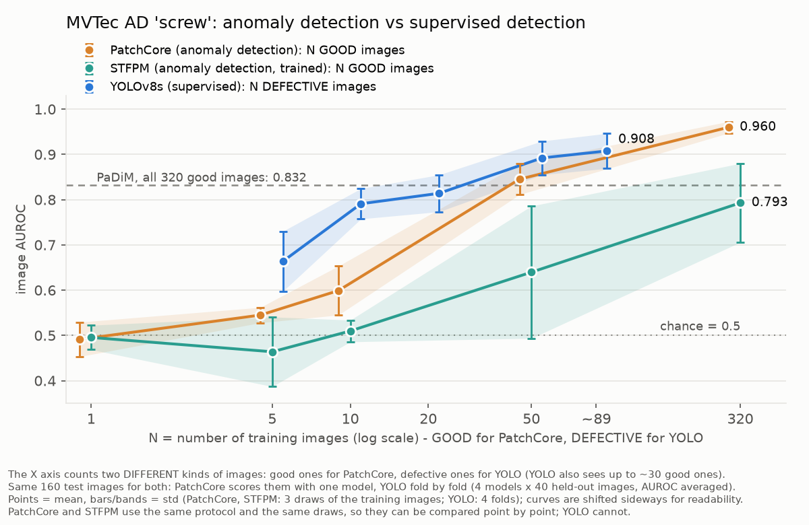
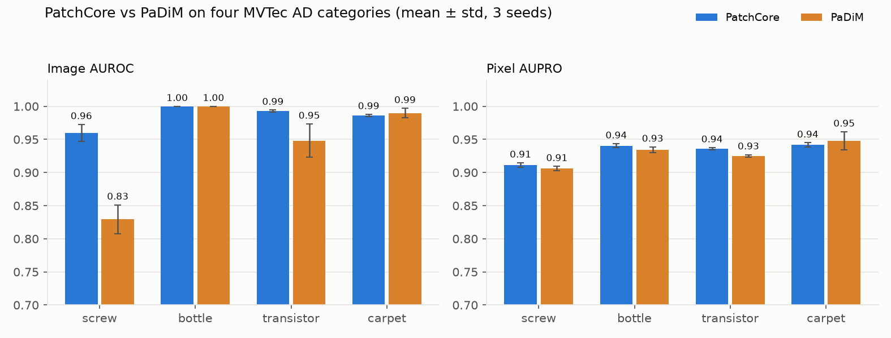
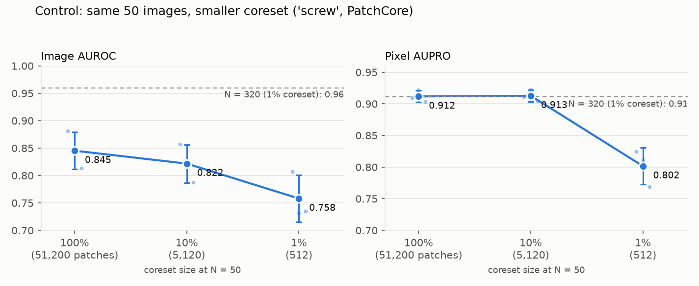
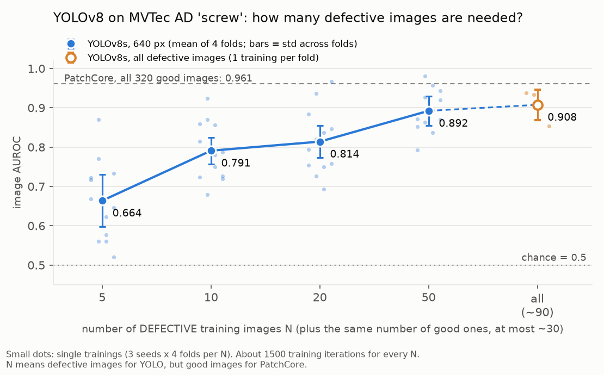
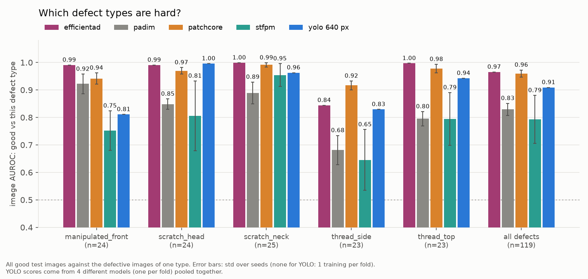

# Visual anomaly detection with limited data: PatchCore, PaDiM and a supervised YOLOv8 baseline on MVTec AD

Small manufacturers rarely have thousands of labelled defect images. They usually have **some photos of good parts and almost no photos of defects**. This project studies how well two unsupervised anomaly-detection methods, **PatchCore** and **PaDiM**, work in that situation, and how performance changes when only a handful of good training images is available. A **supervised YOLOv8 detector**, trained on defect images with bounding boxes, serves as the baseline that answers the practical question: *when is it worth collecting labelled defects instead of using only good images?*

It is the experimental part of my BSc thesis in Artificial Intelligence (Catholic University of Lublin). All results come from the scripts in this repository and are stored as CSV files in this repository.



## Key findings

1. **PatchCore beats PaDiM at image-level detection on the hard categories**, and the two are equal on the easy ones. On `screw`, image AUROC is 0.960 vs 0.829. On `transistor` it is 0.993 vs 0.948. On `bottle` both reach 1.000 and on `carpet` the difference is within noise.
2. **Localisation is about equal.** Pixel AUPRO is within roughly 0.01 between the methods on all four categories.
3. **Few-shot (`screw`, PatchCore):** with 1, 5 or 10 good training images image AUROC stays close to chance (0.49 / 0.55 / 0.60). At 50 images it jumps to 0.85, and with all 320 images it reaches 0.96.
4. **Localisation needs fewer images than detection.** Pixel AUROC (0.981) and AUPRO (0.912) at N = 50 already match the full-data values, while image AUROC does not.
5. **Image diversity matters more than memory-bank size.** With the same 50 images, shrinking the bank from 51,200 to 5,120 patches costs about 0.02 image AUROC. Yet the full-data model uses only 3,276 patches and scores 0.96. A bank of 512 patches is too small (0.76).
6. **Supervised YOLOv8s does not beat PatchCore on `screw`.** Trained on about 90 defective images (plus about 30 good ones) and tested on held-out folds, it reaches image AUROC 0.908 (640 px) and 0.926 (1024 px), against 0.961 for PatchCore and 0.832 for PaDiM (means over 4 folds). The difference between the two YOLO image sizes is within noise.
7. **YOLO needs defective examples and is unstable with few of them.** With N = 5 / 10 / 20 / 50 defective training images the image AUROC is 0.66 / 0.79 / 0.81 / 0.89. The gain flattens after 50 images, N = 10 vs 20 is within noise, and single trainings with the same N differ by 0.05-0.09 AUROC depending on which images were drawn.
8. **The two few-shot curves cannot be compared point by point.** N counts good images for PatchCore and defective images for YOLO, and the two methods are trained on different data (see Limitations). The combined figure shows both curves for orientation only.
9. **The methods fail on different defects.** `thread_side` is the hardest type for all three (image AUROC 0.917 PatchCore, 0.829 YOLO, 0.681 PaDiM). YOLO is clearly weaker than PatchCore on `manipulated_front` (0.811 vs 0.941) and at least as good on `scratch_head` (0.996 vs 0.970). No defective image is missed by PatchCore alone, and 10 of the 119 are missed by all three methods.
10. **Image F1 can mislead.** 74% of the `screw` test images are defective, so predicting "defective" for everything already gives F1 = 0.853. Judge few-shot runs by AUROC.

## Results

All numbers are mean ± standard deviation over 3 seeds (42, 1, 2), on the official MVTec AD test split. PatchCore: WideResNet-50 backbone, layers 2+3, 256 px, 1% coreset, 9 neighbours. PaDiM: WideResNet-50, layers 1+2+3, 200 random channels, 256 px.

### PatchCore vs PaDiM, four categories



| category | method | image AUROC | image F1 | pixel AUROC | pixel AUPRO | pixel F1 |
|---|---|---|---|---|---|---|
| screw | PatchCore | 0.960 ± 0.013 | 0.946 ± 0.003 | 0.981 ± 0.001 | 0.911 ± 0.004 | 0.370 ± 0.003 |
| screw | PaDiM | 0.829 ± 0.022 | 0.888 ± 0.007 | 0.975 ± 0.001 | 0.906 ± 0.003 | 0.233 ± 0.009 |
| bottle | PatchCore | 1.000 ± 0.000 | 0.992 ± 0.000 | 0.985 ± 0.000 | 0.940 ± 0.003 | 0.724 ± 0.001 |
| bottle | PaDiM | 1.000 ± 0.000 | 0.992 ± 0.000 | 0.980 ± 0.001 | 0.934 ± 0.004 | 0.693 ± 0.007 |
| transistor | PatchCore | 0.993 ± 0.001 | 0.945 ± 0.007 | 0.965 ± 0.001 | 0.936 ± 0.002 | 0.603 ± 0.006 |
| transistor | PaDiM | 0.948 ± 0.025 | 0.856 ± 0.030 | 0.976 ± 0.002 | 0.925 ± 0.002 | 0.670 ± 0.016 |
| carpet | PatchCore | 0.986 ± 0.002 | 0.972 ± 0.005 | 0.990 ± 0.000 | 0.942 ± 0.003 | 0.603 ± 0.002 |
| carpet | PaDiM | 0.990 ± 0.007 | 0.979 ± 0.003 | 0.987 ± 0.004 | 0.948 ± 0.014 | 0.529 ± 0.063 |

### Few-shot experiment (`screw`, PatchCore)

N good training images are drawn at random (3 different draws per N). For N ≤ 50 the full memory bank is kept (coreset 100%).

| N train images | coreset | bank size (patches) | image AUROC | image F1 | pixel AUROC | pixel AUPRO | pixel F1 |
|---|---|---|---|---|---|---|---|
| 1 | 100% | 1,024 | 0.491 ± 0.038 | 0.852 ± 0.003 | 0.903 ± 0.009 | 0.691 ± 0.030 | 0.035 ± 0.001 |
| 5 | 100% | 5,120 | 0.545 ± 0.017 | 0.858 ± 0.005 | 0.934 ± 0.006 | 0.759 ± 0.023 | 0.052 ± 0.002 |
| 10 | 100% | 10,240 | 0.599 ± 0.054 | 0.866 ± 0.011 | 0.947 ± 0.006 | 0.803 ± 0.007 | 0.067 ± 0.002 |
| 50 | 100% | 51,200 | 0.845 ± 0.034 | 0.896 ± 0.005 | 0.981 ± 0.003 | 0.912 ± 0.009 | 0.280 ± 0.067 |
| 320 (all) | 1% | 3,276 | 0.960 ± 0.013 | 0.946 ± 0.003 | 0.981 ± 0.001 | 0.911 ± 0.004 | 0.370 ± 0.003 |

The last row uses a different coreset size than the others. To check that this does not explain the gap, I ran a control with the same 50 images and smaller coresets:



| coreset | bank size (patches) | image AUROC | pixel AUROC | pixel AUPRO | pixel F1 |
|---|---|---|---|---|---|
| 100% | 51,200 | 0.845 ± 0.034 | 0.981 ± 0.003 | 0.912 ± 0.009 | 0.280 ± 0.067 |
| 10% | 5,120 | 0.822 ± 0.035 | 0.980 ± 0.003 | 0.913 ± 0.009 | 0.275 ± 0.062 |
| 1% | 512 | 0.758 ± 0.043 | 0.939 ± 0.016 | 0.802 ± 0.029 | 0.243 ± 0.051 |

### Smaller ablations (`screw`, 3 seeds)

| configuration | image AUROC | pixel AUROC | pixel F1 | fit time [s] |
|---|---|---|---|---|
| PatchCore WRN50, 256 px, k=9 | 0.960 ± 0.013 | 0.981 | 0.370 | 38 |
| PatchCore WRN50, 256 px, k=1 | 0.960 ± 0.013 | 0.981 | 0.370 | 37 |
| PatchCore WRN50, 256 px, k=3 | 0.952 ± 0.007 | 0.981 | 0.370 | 38 |
| PatchCore ResNet-18, 256 px, k=9 | 0.953 ± 0.005 | 0.985 | 0.381 | 36 |
| PatchCore WRN50, 384 px, k=9 | 0.976 ± 0.003 | 0.992 | 0.488 | 1231 |
| PaDiM ResNet-18, 256 px | 0.759 ± 0.009 | 0.976 | 0.216 | 19 |
| PaDiM ResNet-18, 384 px | 0.732 ± 0.028 | 0.980 | 0.223 | 26 |
| PaDiM WRN50, 256 px | 0.829 ± 0.022 | 0.975 | 0.233 | 21 |

Higher resolution helps PatchCore on `screw` (small defects) but is about 30 times slower to fit. The number of neighbours `k` only changes the image-level score, never the anomaly map, so pixel metrics are identical for every `k`. Pixel AUPRO is not available for this ablation (it was added to the script later).

### Supervised baseline: YOLOv8s on `screw`

**Protocol.** The 160 test images are split once into 4 stratified folds of 40 (`splits/screw_folds.csv`). The anomaly detectors are trained on the 320 good training images and their scores are cut into the same folds. For each fold, YOLOv8s is trained on the test images of the *other three folds* (about 120 images, about 90 defective, with boxes derived from the ground-truth masks) and scored on the held-out fold, so every test image is scored once by a model that never saw it. Image score = highest box confidence (0 if there is no box). Folds are averaged; the standard deviation is taken across folds (n - 1).

| method | fold 0 | fold 1 | fold 2 | fold 3 | mean ± std over folds |
|---|---|---|---|---|---|
| PatchCore (3 seeds) | 0.954 | 0.970 | 0.953 | 0.967 | 0.961 ± 0.009 |
| PaDiM (3 seeds) | 0.885 | 0.809 | 0.724 | 0.910 | 0.832 ± 0.084 |
| YOLOv8s, 640 px | 0.937 | 0.933 | 0.907 | 0.853 | 0.908 ± 0.039 |
| YOLOv8s, 1024 px | 0.912 | 0.913 | 0.913 | 0.967 | 0.926 ± 0.027 |

**Few-shot YOLO.** For each fold, N defective images (plus the same number of good ones, as far as the pool has them) are drawn at random, with 3 different draws per N. The number of training iterations is kept near 1,500 for every N, so the number of epochs shrinks as N grows.

| N defective images | image AUROC (mean ± std over folds) | worst - best fold | std over draws (mean) |
|---|---|---|---|
| 5 | 0.664 ± 0.066 | 0.587 - 0.733 | 0.082 |
| 10 | 0.791 ± 0.034 | 0.744 - 0.824 | 0.072 |
| 20 | 0.814 ± 0.041 | 0.760 - 0.857 | 0.087 |
| 50 | 0.892 ± 0.037 | 0.839 - 0.923 | 0.049 |
| all (about 90, 1 training) | 0.908 ± 0.039 | 0.853 - 0.937 | - |



### Error analysis by defect type (`screw`)

AUROC of "all 41 good test images vs the defective images of one type" (n = number of defective images). PatchCore and PaDiM: mean over 3 seeds; YOLO: one training per fold, scores of the 4 fold models pooled. Recall = share of defective images found when the threshold keeps 95% of the good images below it.

| defect type | n | AUROC PatchCore | AUROC PaDiM | AUROC YOLO 640 | recall PatchCore | recall PaDiM | recall YOLO 640 |
|---|---|---|---|---|---|---|---|
| manipulated_front | 24 | 0.941 ± 0.020 | 0.922 ± 0.036 | 0.811 | 0.67 | 0.79 | 0.13 |
| scratch_head | 24 | 0.970 ± 0.012 | 0.848 ± 0.019 | 0.996 | 0.83 | 0.50 | 0.96 |
| scratch_neck | 25 | 0.991 ± 0.008 | 0.889 ± 0.039 | 0.963 | 0.96 | 0.76 | 0.92 |
| thread_side | 23 | 0.917 ± 0.016 | 0.681 ± 0.053 | 0.829 | 0.52 | 0.17 | 0.35 |
| thread_top | 23 | 0.978 ± 0.015 | 0.795 ± 0.026 | 0.943 | 0.91 | 0.30 | 0.87 |
| all defects | 119 | 0.960 ± 0.013 | 0.829 ± 0.022 | 0.909 | 0.78 | 0.51 | 0.65 |



Reading the table:

- **AUROC and recall can disagree.** AUROC compares all pairs of good and defective images, recall looks only at the strict end of the ranking. For YOLO on `manipulated_front` the AUROC is 0.81 but only 3 of 24 images are found: many good images get high box confidences, so a threshold that keeps 95% of them below it rejects almost every defect of this type.
- **Overlap of the misses.** At this threshold PatchCore misses 26 images, YOLO 42 and PaDiM 58. Every image PatchCore misses is also missed by at least one other method; 17 of its 26 misses are also YOLO misses, and 10 images are missed by all three methods (mostly `thread_side` and `manipulated_front`).
- **What the most-missed images look like** (the two lowest-scoring images of each method, checked by eye): small defects on the flank of the thread (for example three tiny spots in `thread_side/000`, the most missed image of both PatchCore and YOLO), a small defect at the very tip of the screw (`manipulated_front/022`, YOLO), and a deformed piece of thread with low contrast to the surrounding thread (`thread_top/003`, PatchCore; `thread_side/016` and `021`, PaDiM). These are observations from 2 images per method, not a tested explanation.
- **Caveats.** Each type has 23-25 images, so differences of about 0.03 AUROC between types or methods are not reliable. YOLO has no seed standard deviation (one training per fold), and its scores come from 4 different models. The pooled YOLO AUROC (0.909) is close to, but not the same as, the mean over folds (0.908). The threshold (95% of good images) is arbitrary; other values would change the recall numbers, not the AUROC.

## Method in short

- **PatchCore** stores features of all patches of the good training images (a *memory bank*) and shrinks it with greedy *coreset* subsampling. A test patch is scored by its distance to the nearest stored patch. The image score is the largest patch score.
- **PaDiM** models the features at each image position as a Gaussian (mean and covariance over the training images) and scores a test patch by its Mahalanobis distance to that Gaussian.
- Both use an ImageNet-pretrained CNN as a frozen feature extractor. **No defect image is ever used for training.**
- **YOLOv8s** is a supervised object detector. It is trained on images with defect bounding boxes and used here as an anomaly detector: the image score is the highest box confidence (`conf = 0.001`), and the anomaly map is built from the predicted boxes.

## Metrics

| metric | meaning |
|---|---|
| image AUROC | probability that a random defective image gets a higher score than a random good one |
| image F1 | F1 of the good/defective decision at the model's threshold |
| pixel AUROC | the same at pixel level (inflated by the many easy background pixels) |
| pixel AUPRO | per-defect-region overlap, averaged over thresholds. Treats small defects fairly |
| pixel F1 | F1 of the predicted vs true defect mask |

## Setup

Tested with Python 3.10+, `anomalib 2.7.0`, PyTorch 2.14.1 (CUDA 12.6) on an RTX 4060 Laptop GPU (8 GB).

```bash
python -m venv .venv
# Windows: .venv\Scripts\activate     Linux/macOS: source .venv/bin/activate

# 1) PyTorch with CUDA (pick the right command at https://pytorch.org/get-started/locally/), e.g.:
python -m pip install torch torchvision --index-url https://download.pytorch.org/whl/cu126

# 2) the rest
python -m pip install -r requirements.txt
```

Download the [MVTec AD dataset](https://www.mvtec.com/company/research/datasets/mvtec-ad) (not included in this repository) and extract it, e.g. to `data/mvtec/`. Each category folder must contain `train/good`, `test/<defect types>` and `ground_truth/<defect types>`.

## Usage

```bash
python run_experiment.py --root data/mvtec/screw --category screw --model patchcore \
    --backbone wide_resnet50_2 --coreset-ratio 0.01 --num-neighbors 9 --seeds 42 1 2 --out results.csv
```

Every run appends one row per seed to the CSV file (the header is checked first, so existing results are never overwritten). Main options:

| option | description |
|---|---|
| `--model` | `patchcore` (default) or `padim` |
| `--backbone` | `wide_resnet50_2` (PatchCore default), `resnet18` (PaDiM default), any timm backbone |
| `--coreset-ratio`, `--num-neighbors` | PatchCore memory-bank fraction and neighbours for the image score |
| `--n-features` | PaDiM number of random channels (the paper uses 550 for WRN50, which needs more than 8 GB of GPU memory; I used 200) |
| `--image-size` | input resolution (default 256) |
| `--n-train` | few-shot: draw N random training images for each seed |
| `--seeds` | one run per seed |
| `--save-errors` | save a figure with the worst false positive and false negative |

### Reproducing the experiments

```bash
# 4 categories x 2 methods x 3 seeds   (PowerShell: replace the loop syntax accordingly)
for c in screw bottle transistor carpet; do
  python run_experiment.py --root data/mvtec/$c --category $c --model patchcore --backbone wide_resnet50_2 --coreset-ratio 0.01 --seeds 42 1 2 --out results.csv
  python run_experiment.py --root data/mvtec/$c --category $c --model padim --backbone wide_resnet50_2 --n-features 200 --seeds 42 1 2 --out results.csv
done

# few-shot (full memory bank)
for n in 1 5 10 50; do
  python run_experiment.py --root data/mvtec/screw --category screw --backbone wide_resnet50_2 --coreset-ratio 1.0 --n-train $n --seeds 42 1 2 --out results.csv
done

# coreset control at N = 50
for r in 0.1 0.01; do
  python run_experiment.py --root data/mvtec/screw --category screw --backbone wide_resnet50_2 --coreset-ratio $r --n-train 50 --seeds 42 1 2 --out results.csv
done

# tables and figures from the CSV files in results/
python analysis/make_report.py
```

### Reproducing the supervised comparison (`screw`)

```bash
# 1) the folds (once) and the per-image scores of the anomaly detectors (one file per seed in scores/)
python make_splits.py --root data/mvtec/screw --out splits/screw_folds.csv
python run_experiment.py --root data/mvtec/screw --category screw --model patchcore --backbone wide_resnet50_2 --coreset-ratio 0.01 --seeds 42 1 2 --save-scores --out results.csv
python run_experiment.py --root data/mvtec/screw --category screw --model padim --backbone wide_resnet50_2 --n-features 200 --seeds 42 1 2 --save-scores --out results.csv

# 2) YOLO, for every fold k = 0..3 and image size 640 / 1024 (run names are fold<k>_all_<size>)
python make_yolo_data.py --root data/mvtec/screw --fold 0 --out yolo_data/fold0
yolo detect train data=yolo_data/fold0/data.yaml model=yolov8s.pt imgsz=640 epochs=100 batch=8 seed=42 val=False name=fold0_all_640
python yolo_scores.py --weights runs/detect/fold0_all_640/weights/last.pt --data-dir yolo_data/fold0 \
    --root data/mvtec/screw --fold 0 --imgsz 640 --name fold0_all_640 --out results/yolo_folds.csv

# 3) glue the four folds together and compute AUROC per fold for all methods
python merge_yolo_scores.py
python eval_folds.py

# 4) few-shot YOLO: N defective images, draw (seed) S; epochs = ceil(1500 / ceil(n_train_images / 8))
python make_yolo_data.py --root data/mvtec/screw --fold 0 --n-defect 10 --seed 42     # -> yolo_data/fold0_n10_seed42
#    train as above with name=fold0_n10_seed42_640, then score:
python yolo_scores.py --weights runs/detect/fold0_n10_seed42_640/weights/last.pt --data-dir yolo_data/fold0_n10_seed42 \
    --root data/mvtec/screw --fold 0 --imgsz 640 --name fold0_n10_seed42_640 --n-defect 10 --train-seed 42 --out results/yolo_fewshot.csv

# 5) tables and figures
python analysis/yolo_fewshot.py            # YOLO learning curve
python analysis/anomaly_vs_supervised.py   # both curves in one figure
python analysis/per_defect_type.py --root data/mvtec/screw   # AUROC and missed images per defect type
```

The fixed training settings (`val=False`, last weights, no selection on the test folds) were chosen before looking at any result, so that the folds stay a fair test. `yolo_data/`, `runs/` and `*.pt` are not committed: they are derived from the MVTec AD images.

## Repository structure

```
run_experiment.py        # experiment runner (PatchCore / PaDiM, few-shot, CSV logging, per-image scores)
make_splits.py           # 4 stratified folds of the screw test images -> splits/screw_folds.csv
make_yolo_data.py        # YOLO dataset for one fold (boxes from masks), optional N defective images
yolo_scores.py           # per-image YOLO scores and image / pixel AUROC for one held-out fold
merge_yolo_scores.py     # glues the 4 fold score files of YOLO into one 160-row file
eval_folds.py            # AUROC per fold, mean and std across folds for all methods
analysis/
  make_report.py         # tables (results/summary.md) and figures of the PatchCore / PaDiM study
  yolo_fewshot.py        # table and learning curve of the few-shot YOLO experiment
  anomaly_vs_supervised.py  # both few-shot curves + PaDiM line in one figure
  per_defect_type.py     # AUROC and missed images per defect type
splits/screw_folds.csv   # fold of every test image (path, defect_type, label, fold)
scores/                  # per-image scores of every run (path, label, score)
results/
  four_categories.csv    # 24 runs: 4 categories x 2 methods x 3 seeds
  few_shot.csv           # 21 runs: N = 1, 5, 10, 50 (+ coreset control) and N = 320
  ablation_screw.csv     # 30 runs: neighbours, backbone, resolution, PaDiM backbones
  folds_summary.csv, fold_auroc_per_run.csv   # AUROC per fold for all methods
  yolo_folds.csv         # YOLO trained on all defective images of the other folds
  yolo_fewshot.csv, yolo_fewshot_summary.csv  # 48 few-shot YOLO runs and their summary
  anomaly_vs_supervised.csv   # data of the combined figure
  summary.md             # tables of the PatchCore / PaDiM study
figures/                 # PNG figures
```

CSV columns: `data, category, model, backbone, layers, image_size, coreset_ratio, num_neighbors, seed, n_train, n_test_images, image_AUROC, image_F1Score, pixel_AUROC, pixel_AUPRO, pixel_F1Score, fit_s, test_s`. Empty cells mean "not applicable" (e.g. `coreset_ratio` for PaDiM).

## Limitations

- **Only 3 seeds per setting.** Standard deviations are rough estimates. Differences smaller than about 0.03 AUROC should not be read as real (for instance N = 1 vs 5 vs 10, or 100% vs 10% coreset).
- **The F1 threshold is chosen on the test set** (the validation split equals the test split, `ValSplitMode.SAME_AS_TEST`), so image F1 and pixel F1 are optimistic. AUROC and AUPRO do not depend on a threshold.
- **The few-shot and supervised studies cover a single category** (`screw`). Results for other categories can differ.
- **The supervised comparison has only 4 folds** of 40 images (one image pair is worth about 0.003 AUROC), one YOLO training per fold for the all-data point and 3 draws per N in the few-shot study. Differences below about 0.03 AUROC are noise.
- **YOLO and the anomaly detectors see different training data.** Both are scored on the same 160 test images, but the anomaly detectors train on the 320 good images of `train/good`, while YOLO trains on test images of the other folds (defective images and some good ones). N therefore counts good images for PatchCore and defective images for YOLO, and PatchCore is scored in one pass while YOLO is scored fold by fold with 4 different models (AUROC averaged).
- YOLO image scores are the highest box confidence, so images without any box get 0 and tie. YOLO pixel AUROC (about 0.98) is computed from rectangles and is not comparable with the anomaly maps of PatchCore / PaDiM.
- The training settings of YOLO (YOLOv8s, 100 epochs for the all-data runs, about 1,500 iterations in the few-shot runs) were fixed in advance and not tuned.
- PaDiM uses 200 channels instead of the 550 recommended for WideResNet-50 (GPU memory), so it may be slightly handicapped.
- The explanation for why `screw` needs many images (screws appear in many orientations, and defects are tiny) is a hypothesis that I did not test.
- Results are specific to this hardware and library version. GPU results are reproducible for a given seed, but CPU and GPU runs differ slightly.

## References

- K. Roth et al., *Towards Total Recall in Industrial Anomaly Detection* (PatchCore), CVPR 2022. [arXiv:2106.08265](https://arxiv.org/abs/2106.08265)
- T. Defard et al., *PaDiM: a Patch Distribution Modeling Framework for Anomaly Detection and Localization*, 2020. [arXiv:2011.08785](https://arxiv.org/abs/2011.08785)
- P. Bergmann et al., *MVTec AD: A Comprehensive Real-World Dataset for Unsupervised Anomaly Detection*, CVPR 2019.
- G. Jocher et al., *Ultralytics YOLOv8*. [github.com/ultralytics/ultralytics](https://github.com/ultralytics/ultralytics)
- S. Akcay et al., *Anomalib: A Deep Learning Library for Anomaly Detection*. [arXiv:2202.08341](https://arxiv.org/abs/2202.08341)

## License and data

The code is released under the MIT license (see `LICENSE`). The MVTec AD dataset (and the YOLO datasets derived from it) is **not** included and is licensed by MVTec under CC BY-NC-SA 4.0 (non-commercial use). Please follow its terms.

## Author

Bartosz Purc, BSc student of Artificial Intelligence at KUL, Lublin. [GitHub](https://github.com/Bartek7630) · [LinkedIn](https://www.linkedin.com/in/bartosz-purc-524752332)
