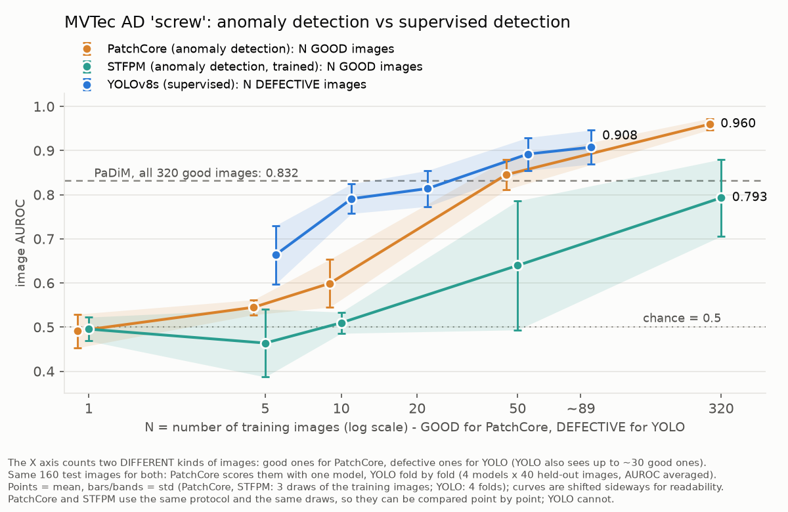
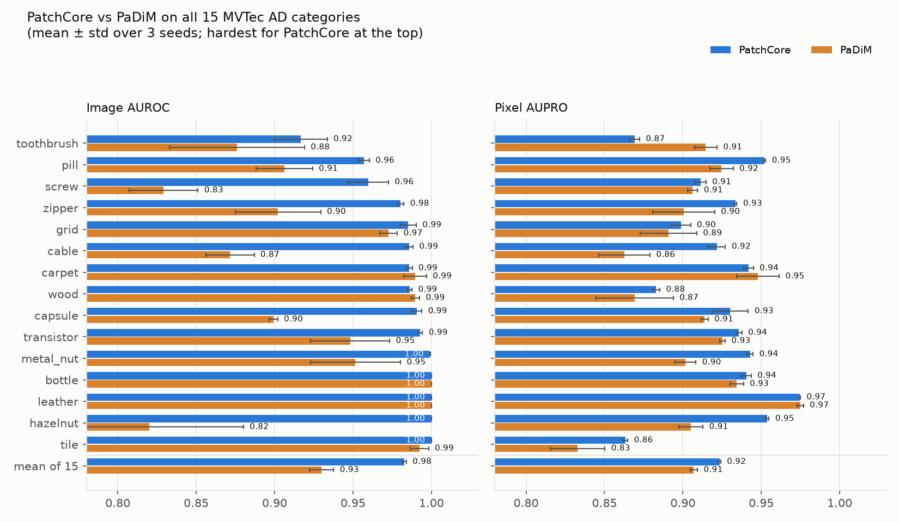
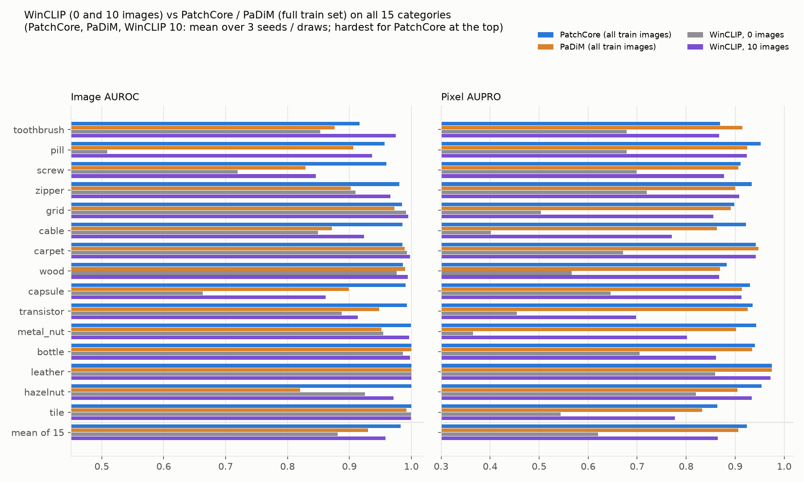
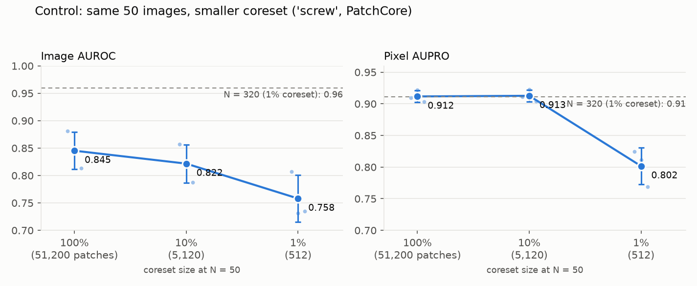
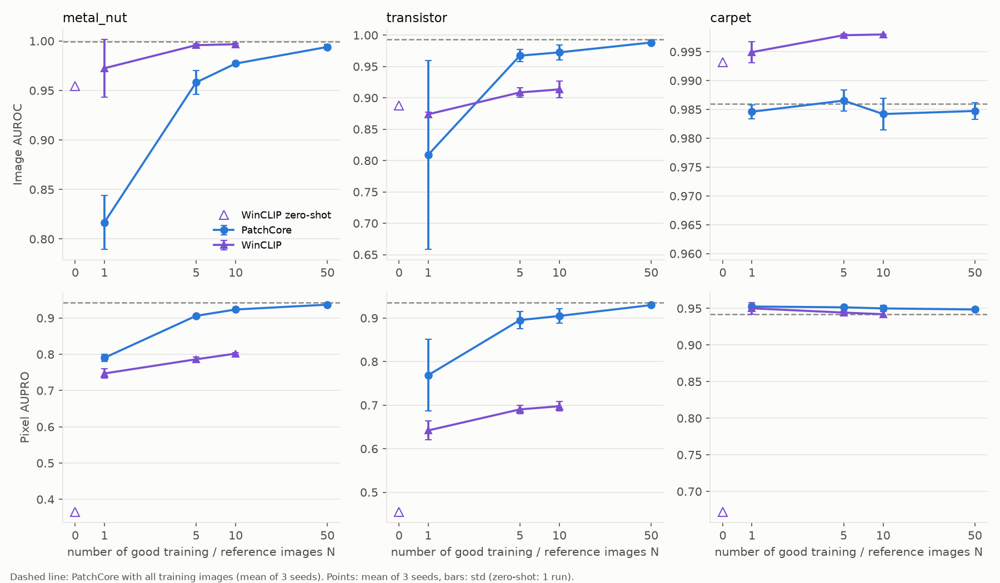
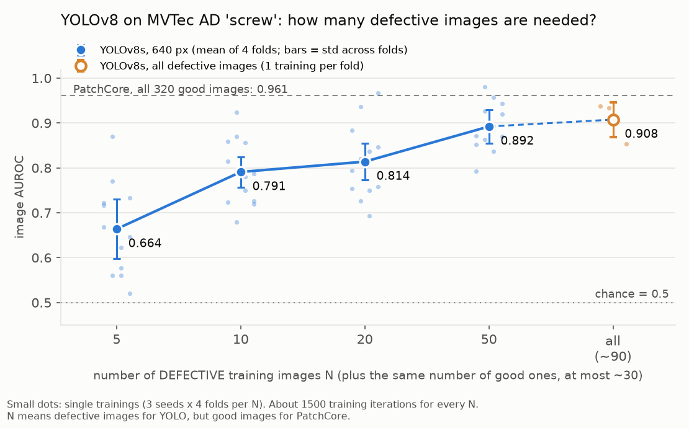
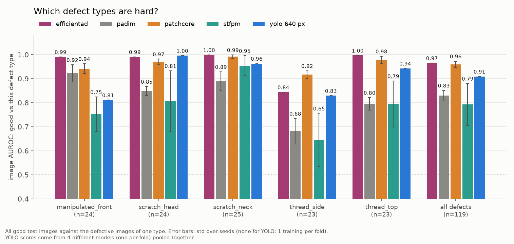

# Visual anomaly detection with limited data: PatchCore, PaDiM, STFPM, EfficientAD, WinCLIP and a supervised YOLOv8 baseline on MVTec AD

Small manufacturers rarely have thousands of labelled defect images. They usually have **some photos of good parts and almost no photos of defects**. This project studies how well five methods that need no defect images work in that situation (**PatchCore, PaDiM, STFPM, EfficientAD** and the vision-language model **WinCLIP**), and how performance changes when only a handful of good images is available. A **supervised YOLOv8 detector**, trained on defect images with bounding boxes, serves as the baseline that answers the practical question: *when is it worth collecting labelled defects instead of using only good images?*

It is the experimental part of my BSc thesis in Artificial Intelligence (Catholic University of Lublin). All results come from the scripts in this repository and are stored as CSV files in this repository. PatchCore and PaDiM were run on all 15 MVTec AD categories; the other methods and the few-shot studies cover the category `screw`.



## Key findings

1. **PatchCore beats PaDiM at image-level detection, but only on objects.** Over all 15 categories the mean image AUROC is 0.983 (PatchCore) vs 0.930 (PaDiM). On the 5 texture categories both reach about 0.99 (0.991 vs 0.989). On the 10 object categories it is 0.978 vs 0.900, with the largest gaps on `hazelnut` (1.000 vs 0.820), `screw` (0.960 vs 0.829) and `cable` (0.986 vs 0.872). The grouping into textures and objects is mine; why objects are harder for PaDiM (it models each image position separately, so changes in pose hurt it) is an explanation I did not test.
2. **Localisation is closer than detection.** Mean pixel AUPRO over 15 categories: 0.924 (PatchCore) vs 0.907 (PaDiM). PaDiM is better on `toothbrush` (0.915 vs 0.869) and about equal on `carpet`.
3. **On `screw` with all training images, EfficientAD and PatchCore are the best** (image AUROC 0.952 ± 0.012 for EfficientAD over 3 seeds, 0.960 ± 0.013 for PatchCore: the same within noise), ahead of supervised YOLOv8s (0.908 ± 0.039), PaDiM (0.829 ± 0.022) and STFPM (0.793 ± 0.087, very unstable across seeds). EfficientAD needs about 2 hours to train, PatchCore 37 seconds.
4. **Few-shot with good images only (`screw`):** with 1, 5 or 10 good images PatchCore stays close to chance (0.49 / 0.55 / 0.60) and STFPM too (0.50 / 0.46 / 0.51). At 50 images PatchCore jumps to 0.85, STFPM reaches 0.64 and a single EfficientAD run 0.83.
5. **WinCLIP needs no training and is the best method with very few images.** Zero-shot (no training image at all) its image AUROC is 0.720. With 1, 5 and 10 reference images it is 0.744 ± 0.083, 0.819 ± 0.014 and 0.846 ± 0.031, i.e. 10 good images give what PatchCore needs about 50 for. One reference image is unreliable (0.65 to 0.82 depending on which image is drawn). WinCLIP uses 240 px input and a text prompt, so it is not the same protocol as the other methods.
6. **Localisation needs fewer images than detection.** For PatchCore, pixel AUROC (0.981) and AUPRO (0.912) at N = 50 already match the full-data values, while image AUROC does not.
7. **Image diversity matters more than memory-bank size.** With the same 50 images, shrinking the PatchCore bank from 51,200 to 5,120 patches costs about 0.02 image AUROC. Yet the full-data model uses only 3,276 patches and scores 0.96. A bank of 512 patches is too small (0.76).
8. **Supervised YOLOv8s does not beat PatchCore on `screw`.** Trained on about 90 defective images (plus about 30 good ones) and tested on held-out folds, it reaches image AUROC 0.908 (640 px) and 0.926 (1024 px), against 0.961 for PatchCore and 0.832 for PaDiM (means over 4 folds). The difference between the two YOLO image sizes is within noise.
9. **YOLO needs defective examples and is unstable with few of them.** With N = 5 / 10 / 20 / 50 defective training images the image AUROC is 0.66 / 0.79 / 0.81 / 0.89. The gain flattens after 50 images, N = 10 vs 20 is within noise, and single trainings with the same N differ by 0.05-0.09 AUROC depending on which images were drawn.
10. **The few-shot curves cannot be compared point by point across the two families.** N counts good images for PatchCore, STFPM, EfficientAD and WinCLIP and defective images for YOLO, and the methods are trained on different data (see Limitations). The combined figure shows all curves for orientation only. PatchCore, STFPM and WinCLIP use the same random draws of good images and can be compared with each other.
11. **The methods fail on different defects.** `thread_side` is the hardest type for all three methods analysed in detail (image AUROC 0.917 PatchCore, 0.829 YOLO, 0.681 PaDiM). YOLO is clearly weaker than PatchCore on `manipulated_front` (0.811 vs 0.941) and at least as good on `scratch_head` (0.996 vs 0.970). WinCLIP zero-shot is at chance on `manipulated_front` (0.497) and reaches 0.73 there only with 10 reference images. No defective image is missed by PatchCore alone, and 10 of the 119 are missed by all three methods.
12. **Image F1 can mislead.** 74% of the `screw` test images are defective, so predicting "defective" for everything already gives F1 = 0.853. Judge few-shot runs by AUROC.
13. **Which differences are real (95% bootstrap intervals, all 15 categories).** PatchCore beats PaDiM significantly on 9 of 15 categories (always in favour of PatchCore): 8 of the 10 objects but only 1 of the 5 textures (`tile`, +0.008). WinCLIP with 10 reference images is significantly worse than PatchCore (trained on all good images) on 5 categories (`cable`, `capsule`, `hazelnut`, `screw`, `transistor`), significantly better on 1 (`carpet`, borderline) and shows no detectable difference on the other 9, including `toothbrush` where the intervals are very wide (42 test images). Ten reference images improve on zero-shot significantly on 9 of 15 categories, most of all on `pill` (0.509 to 0.936). "Not significant" means no evidence of a difference, not that the methods are equal.
14. **With a fair threshold the methods differ much more than AUROC suggests (`screw`).** The threshold is the 95th percentile of the good images of the other 3 folds, so about 5% false alarms are accepted. Then EfficientAD finds 84 ± 10% of the defects (3 seeds), PatchCore 79 ± 10% (a difference within the spread between seeds), YOLOv8s 68-69%, WinCLIP with 10 images 50%, STFPM 48% and PaDiM 46%: a large gap between the first two and the rest, although the AUROC of WinCLIP, STFPM and PaDiM is not so far below (0.85 / 0.79 / 0.83). The F1 with these thresholds is above the 0.853 of the trivial rule "everything is defective" only for EfficientAD (0.90) and PatchCore (0.87); for the others it is 0.63-0.80. With only about 2% defective parts in production, about 80% of the alarms of PatchCore and EfficientAD would be false alarms at this threshold.
15. **The few-shot result from `screw` does not carry over to the other categories as it stands.** On `screw` PatchCore with 5-10 good images is close to chance (0.55-0.60). On `metal_nut` and `transistor` the same setting already gives 0.96-0.98 (N = 5 and 10), and on `carpet` even one image is enough (0.985, flat up to N = 50). WinCLIP is clearly better than PatchCore with 1-10 images on `metal_nut` (0.97-1.00 vs 0.82-0.98), slightly better on `carpet`, but worse on `transistor` from N = 5 on (0.91 vs 0.97). In pixel AUPRO PatchCore is ahead of WinCLIP on `metal_nut` and `transistor` at every N. So "PatchCore needs about 50 images" is a property of `screw`, not of PatchCore; a likely reason is that screws appear in many orientations and have tiny defects, which I did not test.

## Results

All numbers are mean ± standard deviation over 3 seeds (42, 1, 2), on the official MVTec AD test split, unless stated otherwise. PatchCore: WideResNet-50 backbone, layers 2+3, 256 px, 1% coreset, 9 neighbours. PaDiM: WideResNet-50, layers 1+2+3, 200 random channels, 256 px. STFPM: ResNet-18, 100 epochs. EfficientAD: small model (PDN-S), 70,000 steps. WinCLIP: CLIP ViT-B-16-plus-240, 240 px.

### PatchCore vs PaDiM, all 15 categories



Sorted by PatchCore image AUROC (hardest first). Every cell is mean ± std over 3 seeds (90 runs). All other metrics are in `results/fifteen_categories_table.csv` and `results_15.csv`.

| category | PatchCore image AUROC | PaDiM image AUROC | PatchCore pixel AUPRO | PaDiM pixel AUPRO |
|---|---|---|---|---|
| toothbrush | 0.917 ± 0.017 | 0.876 ± 0.043 | 0.869 ± 0.003 | 0.915 ± 0.007 |
| pill | 0.957 ± 0.003 | 0.906 ± 0.018 | 0.952 ± 0.001 | 0.925 ± 0.007 |
| screw | 0.960 ± 0.013 | 0.829 ± 0.022 | 0.911 ± 0.004 | 0.906 ± 0.003 |
| zipper | 0.980 ± 0.002 | 0.902 ± 0.027 | 0.934 ± 0.001 | 0.900 ± 0.020 |
| grid | 0.985 ± 0.005 | 0.973 ± 0.006 | 0.899 ± 0.006 | 0.891 ± 0.018 |
| cable | 0.986 ± 0.002 | 0.872 ± 0.015 | 0.922 ± 0.005 | 0.863 ± 0.016 |
| carpet | 0.986 ± 0.002 | 0.990 ± 0.007 | 0.942 ± 0.003 | 0.948 ± 0.014 |
| wood | 0.986 ± 0.001 | 0.990 ± 0.003 | 0.883 ± 0.002 | 0.869 ± 0.025 |
| capsule | 0.991 ± 0.003 | 0.899 ± 0.003 | 0.930 ± 0.012 | 0.914 ± 0.002 |
| transistor | 0.993 ± 0.001 | 0.948 ± 0.025 | 0.936 ± 0.002 | 0.925 ± 0.002 |
| metal_nut | 0.999 ± 0.000 | 0.952 ± 0.029 | 0.943 ± 0.002 | 0.902 ± 0.007 |
| bottle | 1.000 ± 0.000 | 1.000 ± 0.000 | 0.940 ± 0.003 | 0.934 ± 0.004 |
| leather | 1.000 ± 0.000 | 1.000 ± 0.000 | 0.975 ± 0.000 | 0.975 ± 0.002 |
| hazelnut | 1.000 ± 0.000 | 0.820 ± 0.060 | 0.954 ± 0.001 | 0.905 ± 0.008 |
| tile | 1.000 ± 0.000 | 0.992 ± 0.006 | 0.863 ± 0.002 | 0.833 ± 0.017 |
| **mean of 15** | **0.983 ± 0.001** | **0.930 ± 0.008** | **0.924 ± 0.001** | **0.907 ± 0.002** |

PatchCore's mean image AUROC (0.983) is about 0.8 points below the roughly 99% reported in the original paper. Possible reasons, none of them tested: `toothbrush` (0.917) has only 42 test images, so its score is noisy and alone lowers the mean by about 0.005; a 1% coreset instead of a larger one; 256 px input without the crop used in the paper; and implementation details of `anomalib`. The AUROC for `bottle`, `leather`, `hazelnut` and `tile` is 1.000 for all three seeds.

### WinCLIP and confidence intervals, all 15 categories



WinCLIP (CLIP ViT-B-16-plus-240, 240 px) was run on all 15 categories without any training: zero-shot (1 run, it is deterministic) and with 10 good reference images (3 random draws, seeds 42, 1, 2). Mean over the 15 categories:

| method | image AUROC | pixel AUPRO |
|---|---|---|
| PatchCore (all training images) | 0.983 | 0.924 |
| PaDiM (all training images) | 0.930 | 0.907 |
| WinCLIP, 10 reference images | 0.958 | 0.864 |
| WinCLIP, zero-shot | 0.881 | 0.621 |

Per-category values: `results_winclip_15.csv`, `results/winclip_15_table.csv`, `results/summary.md`. Zero-shot WinCLIP separates good from defective images well on textures (`grid` 0.992, `carpet` 0.993, `leather` 1.000) but fails on `pill` (0.509, chance level), `capsule` (0.663) and `screw` (0.720), and its pixel AUPRO is low everywhere (0.62 on average). The protocols differ (see Limitations): PatchCore and PaDiM see all training images, WinCLIP at most 10.

**Confidence intervals.** `analysis/bootstrap_ci.py` resamples the test images with replacement (2,000 times) and computes the AUROC of every seed on the same resample, averaged over the seeds. The 95% interval is the 2.5th to 97.5th percentile. For a difference between two methods, both methods are scored on the same resampled images (paired bootstrap); a difference is called significant when its interval excludes 0. Results: `results/bootstrap_ci.csv` (AUROC with interval per category and method), `results/bootstrap_diff.csv` (differences).

| comparison | significant | direction | not significant |
|---|---|---|---|
| PatchCore vs PaDiM | 9 of 15 (objects 8 of 10, textures 1 of 5) | PatchCore better in all 9: `cable` +0.114, `capsule` +0.091, `hazelnut` +0.180, `metal_nut` +0.048, `pill` +0.051, `screw` +0.131, `tile` +0.008, `transistor` +0.045, `zipper` +0.078 | `bottle`, `carpet`, `grid`, `leather`, `toothbrush`, `wood` |
| PatchCore vs WinCLIP (10 images) | 6 of 15 | PatchCore better: `cable` +0.062, `capsule` +0.129, `hazelnut` +0.029, `screw` +0.114, `transistor` +0.079; WinCLIP better: `carpet` -0.012 (interval -0.032 to -0.0003) | `bottle`, `grid`, `leather`, `metal_nut`, `pill`, `tile`, `toothbrush`, `wood`, `zipper` |
| WinCLIP 10 images vs zero-shot | 9 of 15 | 10 images better in all 9, most on `pill` +0.427, `capsule` +0.199, `screw` +0.126, `toothbrush` +0.122 | `bottle`, `carpet`, `grid`, `leather`, `tile`, `transistor` |

How to read it: the intervals are wide when the test set is small. `toothbrush` has 42 test images, so PatchCore's 0.917 has the interval 0.807 to 0.998 and the 0.058 advantage of WinCLIP (10 images) over PatchCore on this category is not distinguishable from chance. For `screw` (160 test images) the interval of PatchCore is 0.929 to 0.983 and that of PaDiM 0.763 to 0.887. Categories where every method is at or near 1.0 (`leather`, `bottle`, `tile`) give zero-width intervals, because there is nothing left to resample. With 45 comparisons at the 95% level, about two "significant" results are expected by chance, so the borderline ones (`carpet` PatchCore vs WinCLIP, `tile` PatchCore vs PaDiM) deserve caution.

### All methods on `screw` (full training data)

| method | runs | training images | image AUROC | pixel AUROC | training time [s] | model forward [ms/image] |
|---|---|---|---|---|---|---|
| PatchCore | 3 seeds | 320 | 0.960 ± 0.013 | 0.981 ± 0.001 | 37 | 12.6 |
| PaDiM | 3 seeds | 320 | 0.829 ± 0.022 | 0.975 ± 0.001 | 38 | 4.7 |
| STFPM | 3 seeds | 320 | 0.793 ± 0.087 | 0.946 ± 0.032 | 1243 | 10.1 |
| EfficientAD (S) | 3 seeds | 288 | 0.952 ± 0.012 | 0.968 ± 0.006 | 7312 | 12.4 |
| YOLOv8s, 640 px (supervised) | 4 folds | ~120 (~90 defective) | 0.908 ± 0.039 | 0.978 ± 0.008 † | - | - |
| WinCLIP zero-shot | 1 run | 0 | 0.720 | 0.909 | 0 (no training) | - |
| WinCLIP, 10 reference images | 3 draws | 10 | 0.846 ± 0.031 | 0.971 ± 0.005 | 0 (no training) | - |

`±` = standard deviation over seeds (YOLO: over folds). EfficientAD: 3 seeds (42, 1, 2), 288 training images (10% held out for normalisation). WinCLIP uses 240 x 240 input and needs no training; the 10 reference images are drawn like the PatchCore few-shot images. `-` = not measured. † YOLO pixel AUROC comes from a sample of pixels and a map built from boxes: not comparable with the anomaly maps. Model forward = batch 1, RTX 4060 Laptop, fp32, 256 x 256 input, median of 100 runs, without reading files (`analysis/time_inference.py`); YOLO was not timed.

STFPM is very unstable on `screw` (image AUROC 0.847 / 0.839 / 0.692 for seeds 42 / 1 / 2). EfficientAD takes about 2 hours per run; its three seeds give 0.965 / 0.944 / 0.946 (seed 42 / 1 / 2), so 0.952 ± 0.012, which is not better than PatchCore's 0.960 ± 0.013. The seed 42 run alone (0.965) had looked better.

### Few-shot experiment (`screw`, PatchCore)

N good training images are drawn at random (3 different draws per N). For N ≤ 50 the full memory bank is kept (coreset 100%).

| N train images | coreset | bank size (patches) | image AUROC | image F1 | pixel AUROC | pixel AUPRO | pixel F1 |
|---|---|---|---|---|---|---|---|
| 1 | 100% | 1,024 | 0.491 ± 0.038 | 0.852 ± 0.003 | 0.903 ± 0.009 | 0.691 ± 0.030 | 0.035 ± 0.001 |
| 5 | 100% | 5,120 | 0.545 ± 0.017 | 0.858 ± 0.005 | 0.934 ± 0.006 | 0.759 ± 0.023 | 0.052 ± 0.002 |
| 10 | 100% | 10,240 | 0.599 ± 0.054 | 0.866 ± 0.011 | 0.947 ± 0.006 | 0.803 ± 0.007 | 0.067 ± 0.002 |
| 50 | 100% | 51,200 | 0.845 ± 0.034 | 0.896 ± 0.005 | 0.981 ± 0.003 | 0.912 ± 0.009 | 0.280 ± 0.067 |
| 320 (all) | 1% | 3,276 | 0.960 ± 0.013 | 0.946 ± 0.003 | 0.981 ± 0.001 | 0.911 ± 0.004 | 0.370 ± 0.003 |

The last row uses a different coreset size than the others. To check that this does not explain the gap, I ran a control with the same 50 images and smaller coresets:



| coreset | bank size (patches) | image AUROC | pixel AUROC | pixel AUPRO | pixel F1 |
|---|---|---|---|---|---|
| 100% | 51,200 | 0.845 ± 0.034 | 0.981 ± 0.003 | 0.912 ± 0.009 | 0.280 ± 0.067 |
| 10% | 5,120 | 0.822 ± 0.035 | 0.980 ± 0.003 | 0.913 ± 0.009 | 0.275 ± 0.062 |
| 1% | 512 | 0.758 ± 0.043 | 0.939 ± 0.016 | 0.802 ± 0.029 | 0.243 ± 0.051 |

### Few-shot with good images: STFPM, EfficientAD and WinCLIP (`screw`)

N good images are drawn at random with the same 3 draws as for PatchCore (seeds 42, 1, 2). STFPM trains for 2,000 steps for every N. EfficientAD was run once, for N = 50 only; its training takes the same 70,000 steps regardless of N, so about 2 hours, and its map normalisation statistics for this run come from the test set (a mild form of leakage, see Limitations). WinCLIP does not train: the N images are only used as references (N = 0 is zero-shot, one run, because nothing is random).

| N good images | PatchCore | STFPM | EfficientAD | WinCLIP |
|---|---|---|---|---|
| 0 | - | - | - | 0.720 (1 run) |
| 1 | 0.491 ± 0.038 | 0.496 ± 0.027 | - | 0.744 ± 0.083 |
| 5 | 0.545 ± 0.017 | 0.464 ± 0.077 | - | 0.819 ± 0.014 |
| 10 | 0.599 ± 0.054 | 0.510 ± 0.024 | - | 0.846 ± 0.031 |
| 50 | 0.845 ± 0.034 | 0.640 ± 0.146 | 0.830 (1 run) | - |
| all (288-320) | 0.960 ± 0.013 | 0.793 ± 0.087 | 0.952 ± 0.012 (3 seeds) | - |

Image AUROC. WinCLIP pixel metrics (mean over the 3 draws): pixel AUROC 0.958 / 0.968 / 0.971 and pixel AUPRO 0.839 / 0.867 / 0.877 for N = 1 / 5 / 10 (zero-shot: 0.909 and 0.699). The WinCLIP anomaly maps have low resolution (a 15 x 15 window grid), so the pixel metrics should not be over-interpreted.

### Few-shot on `metal_nut`, `transistor` and `carpet`



The same protocol as for `screw`: N good images (N = 1, 5, 10, 50) drawn at random for PatchCore (coreset 1.0, 3 seeds), and k = 1, 5, 10 reference images for WinCLIP (the same 3 draws) plus a single zero-shot run. Dashed line: PatchCore with all training images. Table: `results/fewshot_3cat_table.md`, raw data: `results_fewshot_3cat.csv`, plot script: `analysis/fewshot_3cat.py`. Image AUROC, mean over 3 seeds (zero-shot: 1 run):

| category | method | N = 0 | N = 1 | N = 5 | N = 10 | N = 50 | all images |
|---|---|---|---|---|---|---|---|
| `metal_nut` | PatchCore | | 0.817 ± 0.027 | 0.958 ± 0.012 | 0.977 ± 0.002 | 0.994 ± 0.003 | 0.999 |
| `metal_nut` | WinCLIP | 0.955 | 0.973 ± 0.029 | 0.996 ± 0.001 | 0.997 ± 0.001 | | |
| `transistor` | PatchCore | | 0.809 ± 0.150 | 0.967 ± 0.010 | 0.973 ± 0.012 | 0.988 ± 0.002 | 0.993 |
| `transistor` | WinCLIP | 0.888 | 0.874 ± 0.003 | 0.909 ± 0.008 | 0.913 ± 0.013 | | |
| `carpet` | PatchCore | | 0.985 ± 0.001 | 0.987 ± 0.002 | 0.984 ± 0.003 | 0.985 ± 0.001 | 0.986 |
| `carpet` | WinCLIP | 0.993 | 0.995 ± 0.002 | 0.998 ± 0.000 | 0.998 ± 0.000 | | |

What the three categories show:
- **PatchCore needs far fewer images here than on `screw`.** With N = 5 it reaches 0.96 (`metal_nut`) and 0.97 (`transistor`), against 0.55 on `screw`. With a single image it is unreliable on the objects (`transistor`: 0.65, 0.82 and 0.95 for the three draws) and fine on the texture (`carpet`, which does not improve with more images).
- **WinCLIP wins at the lowest N on `metal_nut`, not on `transistor`.** On `metal_nut`, one reference image (0.973) already beats PatchCore with 5 images (0.958), and PatchCore only catches up at N = 50. On `transistor` WinCLIP is ahead only at N = 1, where PatchCore is very unstable; from N = 5 on PatchCore is better by about 0.06.
- **Localisation favours PatchCore on objects.** Pixel AUPRO at N = 5: 0.906 vs 0.786 on `metal_nut`, 0.895 vs 0.690 on `transistor`. On `carpet` the two are equal (about 0.95). Zero-shot WinCLIP localises poorly everywhere (AUPRO 0.37, 0.45, 0.67).
- No confidence intervals were computed for these categories, and with 3 seeds only differences of several hundredths should be trusted (the large ones above).

### Smaller ablations (`screw`, 3 seeds)

| configuration | image AUROC | pixel AUROC | pixel F1 | fit time [s] |
|---|---|---|---|---|
| PatchCore WRN50, 256 px, k=9 | 0.960 ± 0.013 | 0.981 | 0.370 | 38 |
| PatchCore WRN50, 256 px, k=1 | 0.960 ± 0.013 | 0.981 | 0.370 | 37 |
| PatchCore WRN50, 256 px, k=3 | 0.952 ± 0.007 | 0.981 | 0.370 | 38 |
| PatchCore ResNet-18, 256 px, k=9 | 0.953 ± 0.005 | 0.985 | 0.381 | 36 |
| PatchCore WRN50, 384 px, k=9 | 0.976 ± 0.003 | 0.992 | 0.488 | 1231 |
| PaDiM ResNet-18, 256 px | 0.759 ± 0.009 | 0.976 | 0.216 | 19 |
| PaDiM ResNet-18, 384 px | 0.732 ± 0.028 | 0.980 | 0.223 | 26 |
| PaDiM WRN50, 256 px | 0.829 ± 0.022 | 0.975 | 0.233 | 21 |

Higher resolution helps PatchCore on `screw` (small defects) but is about 30 times slower to fit. The number of neighbours `k` only changes the image-level score, never the anomaly map, so pixel metrics are identical for every `k`. Pixel AUPRO is not available for this ablation (it was added to the script later).

### Supervised baseline: YOLOv8s on `screw`

**Protocol.** The 160 test images are split once into 4 stratified folds of 40 (`splits/screw_folds.csv`). The anomaly detectors are trained on the 320 good training images and their scores are cut into the same folds. For each fold, YOLOv8s is trained on the test images of the *other three folds* (about 120 images, about 90 defective, with boxes derived from the ground-truth masks) and scored on the held-out fold, so every test image is scored once by a model that never saw it. Image score = highest box confidence (0 if there is no box). Folds are averaged; the standard deviation is taken across folds (n - 1).

| method | fold 0 | fold 1 | fold 2 | fold 3 | mean ± std over folds |
|---|---|---|---|---|---|
| PatchCore (3 seeds) | 0.954 | 0.970 | 0.953 | 0.967 | 0.961 ± 0.009 |
| PaDiM (3 seeds) | 0.885 | 0.809 | 0.724 | 0.910 | 0.832 ± 0.084 |
| YOLOv8s, 640 px | 0.937 | 0.933 | 0.907 | 0.853 | 0.908 ± 0.039 |
| YOLOv8s, 1024 px | 0.912 | 0.913 | 0.913 | 0.967 | 0.926 ± 0.027 |

**Few-shot YOLO.** For each fold, N defective images (plus the same number of good ones, as far as the pool has them) are drawn at random, with 3 different draws per N. The number of training iterations is kept near 1,500 for every N, so the number of epochs shrinks as N grows.

| N defective images | image AUROC (mean ± std over folds) | worst - best fold | std over draws (mean) |
|---|---|---|---|
| 5 | 0.664 ± 0.066 | 0.587 - 0.733 | 0.082 |
| 10 | 0.791 ± 0.034 | 0.744 - 0.824 | 0.072 |
| 20 | 0.814 ± 0.041 | 0.760 - 0.857 | 0.087 |
| 50 | 0.892 ± 0.037 | 0.839 - 0.923 | 0.049 |
| all (about 90, 1 training) | 0.908 ± 0.039 | 0.853 - 0.937 | - |



### Honest decision threshold (`screw`)

F1 with a threshold chosen on the test images is optimistic. `analysis/threshold_by_folds.py` mimics what a factory can do: for each of the 4 folds, the threshold is the 95th percentile of the scores of the **good** images in the other 3 folds (about 5% accepted false alarms); recall and false alarms are then counted on the held-out fold, and the counts of the 4 folds are pooled over all 160 images. Means over 3 seeds where available; YOLO is a single run per size (EfficientAD: 3 seeds on full data, 1 run for N = 50). Full table with the few-shot runs: `results/threshold_by_folds_screw.csv`, per run: `results/threshold_by_folds_screw_per_run.csv`.

| method | recall | false alarms | F1, threshold from other folds | F1, best threshold on the same images (optimistic) |
|---|---|---|---|---|
| EfficientAD (full data, 3 seeds) | 0.840 ± 0.097 | 0.073 | 0.899 | 0.946 |
| PatchCore | 0.790 ± 0.097 | 0.057 | 0.871 | 0.950 |
| YOLOv8s, 1024 px (1 run) | 0.689 | 0.073 | 0.804 | 0.915 |
| YOLOv8s, 640 px (1 run) | 0.681 | 0.073 | 0.798 | 0.919 |
| WinCLIP, 10 reference images | 0.499 ± 0.163 | 0.081 | 0.642 | 0.890 |
| STFPM | 0.482 ± 0.135 | 0.089 | 0.630 | 0.875 |
| PaDiM | 0.457 ± 0.098 | 0.065 | 0.614 | 0.892 |
| WinCLIP, zero-shot (1 run) | 0.252 | 0.098 | 0.392 | 0.861 |

Reading the table:
- **EfficientAD and PatchCore stay close.** With one EfficientAD run (seed 42) the recall had looked much higher (0.93), but with 3 seeds it is 0.84 ± 0.10 against 0.79 ± 0.10 for PatchCore: about 6 of the 119 defective images, less than the spread between seeds of either method. The AUROC difference is also not significant (EfficientAD - PatchCore = -0.008, bootstrap 95% interval -0.040 to 0.026). This is a good example of why a single run must not be trusted. The gap to YOLO (0.68), WinCLIP, STFPM and PaDiM (0.46-0.50) is large compared with this spread.
- **F1 is not a good judge here.** 119 of 160 test images are defective, so "everything is defective" scores F1 = 0.853. Only EfficientAD (0.899) and PatchCore (0.871) are above that with a fair threshold. The optimistic F1 of all methods (0.86-0.96) looks much better than it is.
- **Precision depends on how many parts are defective.** The precision here (0.94-0.98) holds for a test set with 74% defects. For a line with 2% defective parts, the same recall and false-alarm rate give a precision of about 0.22 for PatchCore and 0.19 for EfficientAD: roughly four of five alarms would be false.
- **The target of 5% false alarms is only approximate.** There are 41 good images, so one false alarm is 2.4 points: the realised rates are 4.9%, 7.3% or 9.8%, and the threshold itself comes from about 31 good images, which makes it noisy. The recall of PatchCore varies from 0.71 to 0.90 between seeds with the same 4.9% false alarms.
- **WinCLIP scores are clipped at 1.0.** In one 1-image run the threshold is exactly 1.0, so every clipped good image counts as a false alarm (19.5%).
- **YOLO:** the scores of each fold come from a model trained on the other folds, so the fold thresholds mix scores from different models.

### Error analysis by defect type (`screw`)

AUROC of "all 41 good test images vs the defective images of one type" (n = number of defective images). PatchCore and PaDiM: mean over 3 seeds; YOLO: one training per fold, scores of the 4 fold models pooled. Recall = share of defective images found when the threshold keeps 95% of the good images below it.

| defect type | n | AUROC PatchCore | AUROC PaDiM | AUROC YOLO 640 | recall PatchCore | recall PaDiM | recall YOLO 640 |
|---|---|---|---|---|---|---|---|
| manipulated_front | 24 | 0.941 ± 0.020 | 0.922 ± 0.036 | 0.811 | 0.67 | 0.79 | 0.13 |
| scratch_head | 24 | 0.970 ± 0.012 | 0.848 ± 0.019 | 0.996 | 0.83 | 0.50 | 0.96 |
| scratch_neck | 25 | 0.991 ± 0.008 | 0.889 ± 0.039 | 0.963 | 0.96 | 0.76 | 0.92 |
| thread_side | 23 | 0.917 ± 0.016 | 0.681 ± 0.053 | 0.829 | 0.52 | 0.17 | 0.35 |
| thread_top | 23 | 0.978 ± 0.015 | 0.795 ± 0.026 | 0.943 | 0.91 | 0.30 | 0.87 |
| all defects | 119 | 0.960 ± 0.013 | 0.829 ± 0.022 | 0.909 | 0.78 | 0.51 | 0.65 |



Reading the table:

- **AUROC and recall can disagree.** AUROC compares all pairs of good and defective images, recall looks only at the strict end of the ranking. For YOLO on `manipulated_front` the AUROC is 0.81 but only 3 of 24 images are found: many good images get high box confidences, so a threshold that keeps 95% of them below it rejects almost every defect of this type.
- **Overlap of the misses.** At this threshold PatchCore misses 26 images, YOLO 42 and PaDiM 58. Every image PatchCore misses is also missed by at least one other method; 17 of its 26 misses are also YOLO misses, and 10 images are missed by all three methods (mostly `thread_side` and `manipulated_front`).
- **What the most-missed images look like** (the two lowest-scoring images of each method, checked by eye): small defects on the flank of the thread (for example three tiny spots in `thread_side/000`, the most missed image of both PatchCore and YOLO), a small defect at the very tip of the screw (`manipulated_front/022`, YOLO), and a deformed piece of thread with low contrast to the surrounding thread (`thread_top/003`, PatchCore; `thread_side/016` and `021`, PaDiM). These are observations from 2 images per method, not a tested explanation.
- **Caveats.** Each type has 23-25 images, so differences of about 0.03 AUROC between types or methods are not reliable. YOLO has no seed standard deviation (one training per fold), and its scores come from 4 different models. The pooled YOLO AUROC (0.909) is close to, but not the same as, the mean over folds (0.908). The threshold (95% of good images) is arbitrary; other values would change the recall numbers, not the AUROC.

### WinCLIP by defect type (`screw`)

AUROC of "all 41 good test images vs the defective images of one type" (mean over the 3 draws for N > 0). Recall: share of defective images found when the threshold keeps 95% of the good images below it.

| defect type | n | zero-shot | N = 1 | N = 5 | N = 10 |
|---|---|---|---|---|---|
| manipulated_front | 24 | 0.497 | 0.527 | 0.673 | 0.732 |
| scratch_head | 24 | 0.767 | 0.753 | 0.825 | 0.846 |
| scratch_neck | 25 | 0.756 | 0.856 | 0.928 | 0.939 |
| thread_side | 23 | 0.736 | 0.734 | 0.759 | 0.787 |
| thread_top | 23 | 0.847 | 0.846 | 0.906 | 0.923 |
| all defects | 119 | 0.720 | 0.744 | 0.819 | 0.846 |
| recall at the 95% threshold (all defects) | 119 | 0.28 | 0.30 | 0.39 | 0.50 |

Scores of 1.0 are common for WinCLIP (15 images in the zero-shot run, 44 at N = 1 for seed 42): the score is clipped after normalisation, which creates ties (images with exactly equal scores; AUROC counts a tie between a good and a defective image as half correct).

### Speed

Forward pass per image (model only, no file reading), RTX 4060 Laptop GPU, fp32, 256 x 256 input, median of 100 runs after 20 warm-up runs (`analysis/time_inference.py`). Trained weights were used for PatchCore and PaDiM; STFPM and EfficientAD were timed with untrained weights (speed does not depend on the weights). WinCLIP and YOLO were not timed.

| method | batch 1 [ms/image] | batch 16 [ms/image] | training time on `screw` [s] |
|---|---|---|---|
| PaDiM | 4.7 | 1.0 | 21-49 (mean 38) |
| STFPM | 10.1 | 1.2 | 1240-1246 |
| EfficientAD (S) | 12.4 | 8.8 | 7598 |
| PatchCore | 12.6 | 5.2 | 37-38 |

## Method in short

- **PatchCore** stores features of all patches of the good training images (a *memory bank*) and shrinks it with greedy *coreset* subsampling. A test patch is scored by its distance to the nearest stored patch. The image score is the largest patch score.
- **PaDiM** models the features at each image position as a Gaussian (mean and covariance over the training images) and scores a test patch by its Mahalanobis distance to that Gaussian.
- **STFPM** trains a student network to reproduce the features of a frozen pretrained teacher on good images. On a defect the student and the teacher disagree, and the disagreement is the anomaly score.
- **EfficientAD** also uses a teacher-student pair, but with a very small and fast feature extractor, plus an autoencoder that catches logical errors. Its maps are normalised with statistics from validation images.
- **WinCLIP** is a vision-language model: CLIP compares windows of the image with text descriptions such as "damaged screw" (zero-shot) and, if reference images are given, also with the stored features of these images (few-shot). It is not trained on the target images at all.
- PatchCore, PaDiM, STFPM and EfficientAD use only good images for training. WinCLIP uses none (zero-shot) or a few good ones as references. **No defect image is ever used for training these methods.**
- **YOLOv8s** is a supervised object detector. It is trained on images with defect bounding boxes and used here as an anomaly detector: the image score is the highest box confidence (`conf = 0.001`), and the anomaly map is built from the predicted boxes.

## Metrics

| metric | meaning |
|---|---|
| image AUROC | probability that a random defective image gets a higher score than a random good one |
| image F1 | F1 of the good/defective decision at the model's threshold |
| pixel AUROC | the same at pixel level (inflated by the many easy background pixels) |
| pixel AUPRO | per-defect-region overlap, averaged over thresholds. Treats small defects fairly |
| pixel F1 | F1 of the predicted vs true defect mask |

## Setup

Tested with Python 3.10+, `anomalib 2.7.0`, PyTorch 2.14.1 (CUDA 12.6) on an RTX 4060 Laptop GPU (8 GB).

```bash
python -m venv .venv
# Windows: .venv\Scripts\activate     Linux/macOS: source .venv/bin/activate

# 1) PyTorch with CUDA (pick the right command at https://pytorch.org/get-started/locally/), e.g.:
python -m pip install torch torchvision --index-url https://download.pytorch.org/whl/cu126

# 2) the rest
python -m pip install -r requirements.txt

# 3) only for WinCLIP: this exact version (other versions fail inside anomalib)
python -m pip install open-clip-torch==2.24.0
```

**EfficientAD** additionally needs the [ImageNette](https://github.com/fastai/imagenette) dataset (about 1.5 GB, used by the method for its penalty term); put it in `datasets/imagenette` (or pass `--imagenet-dir`). **WinCLIP** downloads the CLIP weights on first use.

Download the [MVTec AD dataset](https://www.mvtec.com/company/research/datasets/mvtec-ad) (not included in this repository) and extract it, e.g. to `data/mvtec/`. Each category folder must contain `train/good`, `test/<defect types>` and `ground_truth/<defect types>`.

## Usage

```bash
python run_experiment.py --root data/mvtec/screw --category screw --model patchcore \
    --backbone wide_resnet50_2 --coreset-ratio 0.01 --num-neighbors 9 --seeds 42 1 2 --out results.csv
```

Every run appends one row per seed to the CSV file (the header is checked first, so existing results are never overwritten). Main options:

| option | description |
|---|---|
| `--model` | `patchcore` (default), `padim`, `stfpm`, `efficientad` or `winclip` |
| `--backbone` | `wide_resnet50_2` (PatchCore default), `resnet18` (PaDiM and STFPM default), any timm backbone |
| `--coreset-ratio`, `--num-neighbors` | PatchCore memory-bank fraction and neighbours for the image score |
| `--n-features` | PaDiM number of random channels (the paper uses 550 for WRN50, which needs more than 8 GB of GPU memory; I used 200) |
| `--epochs`, `--iterations` | STFPM (100 epochs by default) and EfficientAD (70,000 steps by default); `--iterations` fixes the number of steps instead of epochs |
| `--efficientad-modelsize`, `--imagenet-dir` | EfficientAD model size (`s` or `m`) and the ImageNette folder |
| `--val-split` | where the validation images come from (`auto`: the test split, except for EfficientAD, which takes 10% of the good training images) |
| `--k-shot` | WinCLIP: number of reference images (0 = zero-shot) |
| `--image-size` | input resolution (default 256; WinCLIP always uses 240) |
| `--n-train` | few-shot: draw N random training images for each seed |
| `--seeds` | one run per seed |
| `--save-scores` | save the score of every test image to `scores/` (needed for the per-defect analysis) |
| `--save-errors` | save a figure with the worst false positive and false negative |

### Reproducing the experiments

```bash
# 15 categories x 2 methods x 3 seeds (PowerShell script, resumable, about 1.5 h on an RTX 4060 Laptop)
powershell -ExecutionPolicy Bypass -File scripts/run_15_categories.ps1

# or for one category in bash:
for c in screw bottle transistor carpet; do
  python run_experiment.py --root data/mvtec/$c --category $c --model patchcore --backbone wide_resnet50_2 --coreset-ratio 0.01 --seeds 42 1 2 --out results.csv
  python run_experiment.py --root data/mvtec/$c --category $c --model padim --backbone wide_resnet50_2 --n-features 200 --seeds 42 1 2 --out results.csv
done

# few-shot PatchCore (full memory bank)
for n in 1 5 10 50; do
  python run_experiment.py --root data/mvtec/screw --category screw --backbone wide_resnet50_2 --coreset-ratio 1.0 --n-train $n --seeds 42 1 2 --out results.csv
done

# coreset control at N = 50
for r in 0.1 0.01; do
  python run_experiment.py --root data/mvtec/screw --category screw --backbone wide_resnet50_2 --coreset-ratio $r --n-train 50 --seeds 42 1 2 --out results.csv
done

# STFPM: full data, then few-shot (2,000 steps for every N)
python run_experiment.py --root data/mvtec/screw --category screw --model stfpm --seeds 42 1 2 --save-scores --out results.csv
for n in 1 5 10 50; do
  python run_experiment.py --root data/mvtec/screw --category screw --model stfpm --n-train $n --iterations 2000 --seeds 42 1 2 --out results.csv
done

# EfficientAD (about 2 hours per run): full data, and N = 50
python run_experiment.py --root data/mvtec/screw --category screw --model efficientad --imagenet-dir datasets/imagenette --seeds 42 --save-scores --out results.csv
python run_experiment.py --root data/mvtec/screw --category screw --model efficientad --imagenet-dir datasets/imagenette --n-train 50 --val-split same_as_test --seeds 42 --out results.csv

# WinCLIP: zero-shot (one run) and few-shot (3 draws)
python run_experiment.py --root data/mvtec/screw --category screw --model winclip --k-shot 0 --seeds 42 --save-scores --out results.csv
for k in 1 5 10; do
  python run_experiment.py --root data/mvtec/screw --category screw --model winclip --k-shot $k --seeds 1 2 42 --save-scores --out results.csv
done

# speed, summary table, tables and figures from the CSV files in results/
python analysis/time_inference.py
python analysis/make_summary_table.py
python analysis/make_report.py
python analysis/anomaly_vs_supervised.py
```

`make_report.py` reads `results_15.csv` (repository root or `results/`) to build the 15-category table and figure. The WinCLIP rows used by the plots are stored in `results/winclip_fewshot.csv`.

### Reproducing the supervised comparison (`screw`)

```bash
# 1) the folds (once) and the per-image scores of the anomaly detectors (one file per seed in scores/)
python make_splits.py --root data/mvtec/screw --out splits/screw_folds.csv
python run_experiment.py --root data/mvtec/screw --category screw --model patchcore --backbone wide_resnet50_2 --coreset-ratio 0.01 --seeds 42 1 2 --save-scores --out results.csv
python run_experiment.py --root data/mvtec/screw --category screw --model padim --backbone wide_resnet50_2 --n-features 200 --seeds 42 1 2 --save-scores --out results.csv

# 2) YOLO, for every fold k = 0..3 and image size 640 / 1024 (run names are fold<k>_all_<size>)
python make_yolo_data.py --root data/mvtec/screw --fold 0 --out yolo_data/fold0
yolo detect train data=yolo_data/fold0/data.yaml model=yolov8s.pt imgsz=640 epochs=100 batch=8 seed=42 val=False name=fold0_all_640
python yolo_scores.py --weights runs/detect/fold0_all_640/weights/last.pt --data-dir yolo_data/fold0 \
    --root data/mvtec/screw --fold 0 --imgsz 640 --name fold0_all_640 --out results/yolo_folds.csv

# 3) glue the four folds together and compute AUROC per fold for all methods
python merge_yolo_scores.py
python eval_folds.py

# 4) few-shot YOLO: N defective images, draw (seed) S; epochs = ceil(1500 / ceil(n_train_images / 8))
python make_yolo_data.py --root data/mvtec/screw --fold 0 --n-defect 10 --seed 42     # -> yolo_data/fold0_n10_seed42
#    train as above with name=fold0_n10_seed42_640, then score:
python yolo_scores.py --weights runs/detect/fold0_n10_seed42_640/weights/last.pt --data-dir yolo_data/fold0_n10_seed42 \
    --root data/mvtec/screw --fold 0 --imgsz 640 --name fold0_n10_seed42_640 --n-defect 10 --train-seed 42 --out results/yolo_fewshot.csv

# 5) tables and figures
python analysis/yolo_fewshot.py            # YOLO learning curve
python analysis/anomaly_vs_supervised.py   # both curves in one figure
python analysis/per_defect_type.py --root data/mvtec/screw   # AUROC and missed images per defect type
```

All scripts of this section take the category from the `--root` folder name or from `--category` (default `screw`). For another category, e.g. `metal_nut`, use `--category metal_nut`, name the YOLO runs `metal_nut_fold<k>_all_<size>`, and the outputs get the category in their name (`splits/metal_nut_folds.csv`, `yolo_data/metal_nut/fold<k>`, `results/folds_summary_metal_nut.csv`). `scores/` holds files of many categories; `eval_folds.py` and `per_defect_type.py` read only the files that start with `<category>_`.

The fixed training settings (`val=False`, last weights, no selection on the test folds) were chosen before looking at any result, so that the folds stay a fair test. `yolo_data/`, `runs/` and `*.pt` are not committed: they are derived from the MVTec AD images.

## Repository structure

```
run_experiment.py        # experiment runner (PatchCore / PaDiM / STFPM / EfficientAD / WinCLIP, few-shot, CSV logging, per-image scores)
make_splits.py           # 4 stratified folds of the screw test images -> splits/screw_folds.csv
make_yolo_data.py        # YOLO dataset for one fold (boxes from masks), optional N defective images
yolo_scores.py           # per-image YOLO scores and image / pixel AUROC for one held-out fold
merge_yolo_scores.py     # glues the 4 fold score files of YOLO into one 160-row file
eval_folds.py            # AUROC per fold, mean and std across folds for all methods
scripts/
  run_15_categories.ps1  # PatchCore and PaDiM on all 15 categories (resumable)
analysis/
  make_report.py         # tables (results/summary.md) and figures: four and fifteen categories, few-shot, ablation
  make_summary_table.py  # one table for all methods on screw
  time_inference.py      # forward-pass latency per image (batch 1 and 16)
  yolo_fewshot.py        # table and learning curve of the few-shot YOLO experiment
  anomaly_vs_supervised.py  # all few-shot curves + PaDiM line in one figure
  per_defect_type.py     # AUROC and missed images per defect type
splits/screw_folds.csv   # fold of every test image (path, defect_type, label, fold)
scores/                  # per-image scores of every run (path, label, score)
results_15.csv           # 90 runs: 15 categories x 2 methods x 3 seeds
results/
  four_categories.csv    # 24 runs: 4 categories x 2 methods x 3 seeds
  fifteen_categories_table.csv   # mean and std per category and method (from results_15.csv)
  few_shot.csv           # 21 runs: PatchCore N = 1, 5, 10, 50 (+ coreset control) and N = 320
  stfpm_screw.csv, stfpm_fewshot.csv   # STFPM full-data runs and few-shot runs
  efficientad_screw.csv, efficientad_fewshot.csv   # EfficientAD: full data and N = 50 (one run each)
  winclip_fewshot.csv    # WinCLIP: zero-shot and N = 1, 5, 10 (10 runs)
  ablation_screw.csv     # 30 runs: neighbours, backbone, resolution, PaDiM backbones
  inference_time.csv     # latency measurements
  summary_all_methods.csv/.md   # table of all methods on screw
  folds_summary.csv, fold_auroc_per_run.csv   # AUROC per fold for all methods
  yolo_folds.csv         # YOLO trained on all defective images of the other folds
  yolo_fewshot.csv, yolo_fewshot_summary.csv  # 48 few-shot YOLO runs and their summary
  auroc_by_defect_type.csv, recall_by_defect_type.csv   # per-defect-type analysis
  anomaly_vs_supervised.csv   # data of the combined figure
  summary.md             # tables of the PatchCore / PaDiM study
figures/                 # PNG figures
```

CSV columns: `data, category, model, backbone, layers, image_size, coreset_ratio, num_neighbors, epochs, steps, seed, val_split, n_train, n_test_images, image_AUROC, image_F1Score, pixel_AUROC, pixel_AUPRO, pixel_F1Score, fit_s, test_s`. Empty cells mean "not applicable" (e.g. `coreset_ratio` for PaDiM). For WinCLIP, `n_train` is the number of reference images (0 = zero-shot) and `fit_s` is 0 because nothing is trained.

## Limitations

- **The bootstrap intervals describe the test set only.** They show how much a result would change with a different sample of test images, not with a different training run or random seed (seeds are averaged inside each resample and reported separately as standard deviations). Intervals were not corrected for the 45 comparisons.
- **Only 3 seeds per setting.** Standard deviations are rough estimates. Differences smaller than about 0.03 AUROC should not be read as real (for instance N = 1 vs 5 vs 10, or 100% vs 10% coreset).
- **The F1 threshold is chosen on the test set** (the validation split equals the test split, `ValSplitMode.SAME_AS_TEST`), so image F1 and pixel F1 are optimistic. AUROC and AUPRO do not depend on a threshold. The section "Honest decision threshold" repeats the evaluation for `screw` with a threshold taken from good images of other folds.
- **PatchCore, PaDiM and WinCLIP (zero-shot and 10 images) cover 15 categories; the few-shot study of PatchCore and WinCLIP covers `screw`, `metal_nut`, `transistor` and `carpet`; everything else covers a single one.** STFPM, EfficientAD, YOLO and the other few-shot studies use `screw` only. Results for other categories can differ.
- **The supervised comparison has only 4 folds** of 40 images (one image pair is worth about 0.003 AUROC), one YOLO training per fold for the all-data point and 3 draws per N in the few-shot study. Differences below about 0.03 AUROC are noise.
- **YOLO and the anomaly detectors see different training data.** Both are scored on the same 160 test images, but the anomaly detectors train on the 320 good images of `train/good`, while YOLO trains on test images of the other folds (defective images and some good ones). N therefore counts good images for PatchCore and defective images for YOLO, and PatchCore is scored in one pass while YOLO is scored fold by fold with 4 different models (AUROC averaged).
- YOLO image scores are the highest box confidence, so images without any box get 0 and tie. YOLO pixel AUROC (about 0.98) is computed from rectangles and is not comparable with the anomaly maps of PatchCore / PaDiM.
- **EfficientAD: one run per setting, no error bars.** A run takes about 2 hours. The full-data run holds out 10% of the training images for map normalisation; the N = 50 run uses the test set for the normalisation statistics (`--val-split same_as_test`), so the two EfficientAD points are not computed the same way.
- **STFPM** was trained with the paper's 100 epochs on the full data and with a fixed 2,000 steps in the few-shot runs, with ResNet-18 and no tuning. Its variance across seeds is large, so its numbers are rough.
- **WinCLIP uses a different protocol:** 240 px input and CLIP normalisation instead of 256 px, a text prompt built from the category name (`screw`) with no tuning, and a single deterministic zero-shot run. Its anomaly maps are low-resolution, and its scores are clipped at 1.0, which creates ties. I did not test how sensitive the result is to the class name.
- **Two bugs of `anomalib 2.7.0` are worked around in `run_experiment.py`** for WinCLIP few-shot: the model reads `pre_processor.test_transform`, which does not exist, and the reference-image loader has no collate function. The workaround applies the same resize and normalisation as for the test images; a different `anomalib` version may not need it.
- The training settings of YOLO (YOLOv8s, 100 epochs for the all-data runs, about 1,500 iterations in the few-shot runs) were fixed in advance and not tuned.
- PaDiM uses 200 channels instead of the 550 recommended for WideResNet-50 (GPU memory), so it may be slightly handicapped.
- The explanation for why `screw` needs many images (screws appear in many orientations, and defects are tiny) is a hypothesis that I did not test.
- Results are specific to this hardware and library version. GPU results are reproducible for a given seed, but CPU and GPU runs differ slightly.

## References

- K. Roth et al., *Towards Total Recall in Industrial Anomaly Detection* (PatchCore), CVPR 2022. [arXiv:2106.08265](https://arxiv.org/abs/2106.08265)
- T. Defard et al., *PaDiM: a Patch Distribution Modeling Framework for Anomaly Detection and Localization*, 2020. [arXiv:2011.08785](https://arxiv.org/abs/2011.08785)
- G. Wang et al., *Student-Teacher Feature Pyramid Matching for Anomaly Detection* (STFPM), 2021. [arXiv:2103.04257](https://arxiv.org/abs/2103.04257)
- K. Batzner et al., *EfficientAD: Accurate Visual Anomaly Detection at Millisecond-Level Latencies*, WACV 2024. [arXiv:2303.14535](https://arxiv.org/abs/2303.14535)
- J. Jeong et al., *WinCLIP: Zero-/Few-Shot Anomaly Classification and Segmentation*, CVPR 2023. [arXiv:2303.14814](https://arxiv.org/abs/2303.14814)
- A. Radford et al., *Learning Transferable Visual Models From Natural Language Supervision* (CLIP), 2021. [arXiv:2103.00020](https://arxiv.org/abs/2103.00020)
- P. Bergmann et al., *MVTec AD: A Comprehensive Real-World Dataset for Unsupervised Anomaly Detection*, CVPR 2019.
- G. Jocher et al., *Ultralytics YOLOv8*. [github.com/ultralytics/ultralytics](https://github.com/ultralytics/ultralytics)
- S. Akcay et al., *Anomalib: A Deep Learning Library for Anomaly Detection*. [arXiv:2202.08341](https://arxiv.org/abs/2202.08341)

## License and data

The code is released under the MIT license (see `LICENSE`). The MVTec AD dataset (and the YOLO datasets derived from it) is **not** included and is licensed by MVTec under CC BY-NC-SA 4.0 (non-commercial use). Please follow its terms.

## Author

Bartosz Purc, BSc student of Artificial Intelligence at KUL, Lublin. [GitHub](https://github.com/Bartek7630) · [LinkedIn](https://www.linkedin.com/in/bartosz-purc-524752332)
